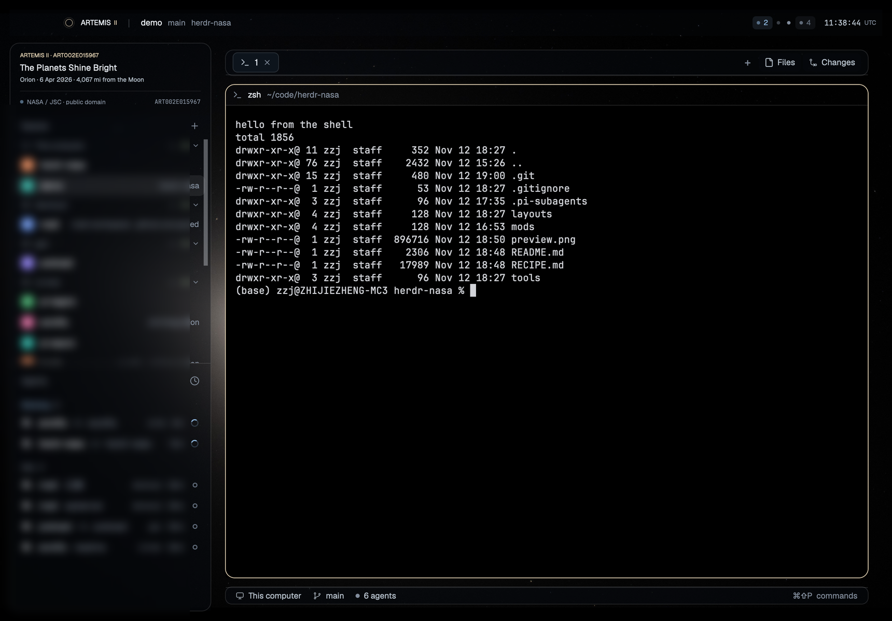

# Artemis

A Herdr layout built on one NASA photograph: ART002E015967, *The Planets Shine
Bright* — the Artemis II crew's view of the Moon eclipsing the Sun from Orion,
6 April 2026, 4,067 mi from the Moon.



The photograph is the window's ground, whole: the entire 3:2 frame, uncropped and
ungraded, placed with `fit: "contain"`. Where the window is a different shape the
layout paints the frame's own border colour — measured off the picture, `#030304` —
so the letterbox is not a bar, it is the photograph running out of stars. Nothing
in the layout paints a background unless it is smoked glass (`#070b1240`, 25 %) or a
20 % tint (`#0e162133`), so the sky, the disc and its corona are behind the rail, the
tabs and the panes rather than in a picture block of their own — and a pane's paper
is 25 % smoke, so the Moon's limb, its craters and the corona read straight through the
text.

**What it gives you**

- the whole frame, never cropped: in a 16:10 window it fills the height with 90 px of the same near-black at
  either side (at 2880 px wide); in a tall window it is a band across the middle
  with the same near-black above and below;
- square plates throughout: the rail, the tab strip, the pane and the status bar are
  right-angled sheets of smoke, so nothing rounds a corner the photograph does not;
- menu surfaces (`popover`, `raised`, `input`) stay opaque, because a menu over a
  photograph needs a floor;
- **a system monitor at the right end of the status bar**: the CPU and memory of the machine the
  shown space lives on — this computer, or the host that space's terminals run on, read over the
  connection Herdr already keeps to it (`iostat`/`vm_stat` on macOS, `/proc` on Linux, all
  read-only), a number and a twelve-tick sparkline each, sampled every three seconds; switch to a
  space on another machine and the readings become that machine's. The mod never runs ssh and holds
  no key, and a machine that cannot answer draws nothing at all;
- the bar's own mod (`artemis-bar`) binds no key, starts no program, and only asks Herdr to
  minimise, maximise or close the window; neither it nor the monitor touches the network.

**Install.** Copy `layouts/`, `mods/` and `backgrounds/` into `~/.config/herdr-app/`
(`backgrounds/artemis.jpg` is the ground — without it the window has no photograph),
check the mods, then switch:

```sh
herdr-app check ~/.config/herdr-app/mods/artemis-bar
herdr-app check ~/.config/herdr-app/mods/sysmon
herdr-app do layout.switch --name artemis
herdr-app status
```

**[RECIPE.md](RECIPE.md)** is the brief it was built from: every size and colour,
the node tree, the two mods, the picture, and the one thing this layout cannot do.

The photograph is `art002e015967` from
[nasa.gov](https://www.nasa.gov/image-detail/amf-art002e015967/): a US government
work, public domain, credit NASA / JSC, imply no endorsement. The layout ships the
frame re-encoded at 4096 px wide (`backgrounds/artemis.jpg`, 1.0 MB) — the same
pixels, no crop, no grade. The lists in the preview are blurred on purpose; they
hold a real machine's own spaces.
