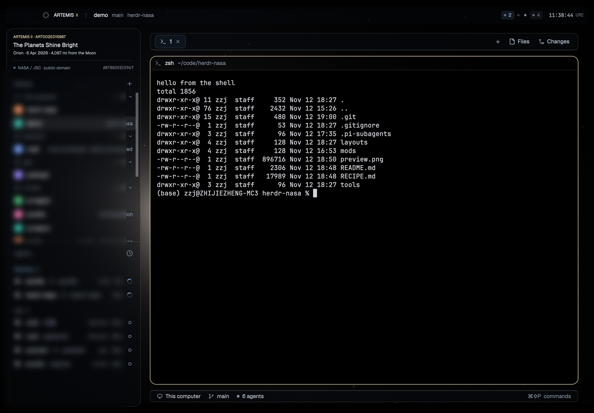

# Artemis

A Herdr layout whose ground is one NASA photograph: ART002E015967, *The Planets Shine Bright*
— the Artemis II crew's view of the Moon eclipsing the Sun from Orion, 6 April 2026, 4,067 mi
from the Moon. The whole frame, uncropped and ungraded, sits behind the entire window with
`fit: "contain"`; where the window is a different shape the layout paints the frame's own
border colour (`#030304`), so the empty part of the window is not a bar but the photograph
running out of stars. Nothing is filled flat: the rail, the tab strip, the status bar and the
panel are 25 % smoke, the containers 20 % of the same `#0e1621`, and the pane its own 32 % — so the
sky, the disc and its corona sit behind the whole interface — and the pane's tint is drawn by the
frame, so it stops on its corner's arc instead of squaring it. Every plate carries a corner — 14 px
on the rail, the pane and the panel, 12 on the tab strip, 10 on the status bar — and the frame clips
its own fill and the header's divider rule to that curve; the header band, which a mod paints, is
rounded by the mod instead.

The status bar's right end carries a small system monitor: the CPU, memory and network of the
machine the shown space lives on — this computer, or the host that space's terminals run on — a
number and a twelve-tick sparkline each, read every second. Every machine with a space is
sampled, not just the shown one, so moving to another host shows its numbers at once instead of
starting from nothing; the same reading is drawn under each machine's name in the rail. It reads
them over the connection Herdr already has (`exec(…, {on})`, i.e. herdr-core on that machine): no
ssh, no key handling, no network of the mod's own — only read-only queries run there (`uname`,
`sysctl`, `iostat`, `vm_stat`, `netstat -ib` on macOS; one `sh -c` over `/proc` on Linux).



## What you see

**The window.** Root `padding` `0`, `gap` `10`, `titlebar: none`, traffic lights at `[14, 13]`,
theme `graphite` with the `colors` map below, terminal padding `[20, 24]`, `terminal_opacity`
`0`, and `background` `{ "image": "backgrounds/artemis.jpg", "fit": "contain" }`.

**The ground.** The photograph, whole: 3:2, no crop, no grade, no vignette, no fade. `contain`
fits it inside the window and centres it. An aspect wider than 3:2 (a 16:10 window) leaves the
same near-black at the sides — 90 px either side at 2880 px wide; an aspect narrower than 3:2 (a
tall window) leaves it above and below, and the picture becomes a band across the middle. Those
bars are `canvas` `#030304` — measured off the frame's own outer 8 px (mean `2.84, 3.02, 3.61`)
— so the picture's edge and the window's edge are the same colour and there is no seam to see.
What the photograph contributes: its near-black sky (mean luminance 11 of 255) with the frame's
own stars, the Moon's disc in its left third, the corona's ring around it, and Saturn and Mars
as two small dots to the right of the disc.

**Smoked glass.** `colors.background` is `#0e162133` — 20 % of a dark blue-grey — so every node's
default fill is a thin smoke over the photograph rather than a hole or a slab, and the pane adds a
32 % tint of the same colour, `"background": "#0e162152"` in `content.pane`: drawn by the frame,
clipped to its arc. A shell pane reads (7, 10, 15) over the frame's black, and the Moon's limb, the
craters, the corona and the stars show through it, so the terminal is written on the photograph
rather than in a box on it. `terminal_opacity` is `0`, not `0.25`: a terminal's own *paper* is one
square rect the app draws and does not clip to the pane's radius, so at any alpha above zero it
squares every corner the frame rounds (measured — see *Watch out*); the pane's fill does the same
job, on the right side of the curve. `terminal_padding` `[20, 24]` leaves the picture as a mount
inside each pane, which is where the glass reads even over the frame's black. `chrome` is
`#00000000` on purpose: the mods that sit on the photograph paint `chrome` (the status bar's
`artemis-workspace-status`, `.bg(t.chrome)`), so a transparent `chrome` is what keeps their type on
the photograph instead of on a band across the
top of the window. Every plate that *should* be visible names the literal `#070b1240` instead.

**The four plates** carry the sturdier version of the same smoke — the literal `#070b1240`
(25 % of `#070b12`) with a `1px` border of `#ffffff1f`, and a corner:

| plate | size | radius |
|---|---|---|
| `sidebar` (the rail) | 292 px, `min` 220, `max` 420 | 14 |
| `tabs` | 38 px tall, `window_drag: true` | 12 |
| `status` | 26 px tall — a row of two mods: `workspace-status` and `sysmon`, 480 px | 10 |
| `panel` (files / changes) | 340 px, `min` 280, `max` 900, `hidden: true` | 14 |

*Watch out:* `solid` and `solid_foreground` are a **fill and its text**, not two greys. Every shipped
mod that has a primary button pairs them — the `confirm` dialog's Yes, `changes`' Commit,
`machine-add`'s Add, `prompt`'s primary — and every shipped theme's `solid` is a bright accent
(`#7d82d9`, `#dcd7ba`, `#82FB9C`) with a dark `solid_foreground`. This theme started with
`solid` `#111820` and `solid_foreground` `#0a0f15`: near-black on near-black, so the "Close space?"
dialog's Confirm was invisible. Measured after the fix: fill `(233,216,185)`, text `(10,12,17)`,
14.0:1.


**The pane** is a bare frame: it carries its own 32 % tint (`content.pane.background`), gets a
`1px` `#ffffff1f` border (the pane holding the keyboard takes `accent` `#e9d8b9` instead) and
radius 14. The `artemis-pane` header
sits 30 px at the top, always visible: program icon, title, folder, the agent's status (the breathing
ring,
`Needs you` while blocked, a dot when done), and — on hover only — split-right, split-down, zoom
and close. The header paints `theme().background`, i.e. a second 20 % tint, plus a 1 px `border`
rule: two thin layers rather than a slab, which is what keeps it from fighting the photograph.
The frame clips its own fill, its border and the divider rule to the arc, but
a mod's own view — the header band — is drawn on top of that clip, and the terminal view is not
clipped at all: so the band rounds itself, to the frame's radius
minus the 1 px border (13 against 14), and its tint stops on the curve exactly where the pane's
fill does.

**Top bar — gone, and `mods/artemis-bar` with it.** The layout used to open with a 38 px
`window_drag` strip carrying the mark, the space's name and branch, the folder leaf, the tab's name
and a UTC clock. The mark now sits at the far left of the status bar and the strip is deleted; the
mod file is kept, unreferenced, because putting the block back (38 px block, `window_drag: true`,
`content.mod: "artemis-bar"`, first child of the root) restores the old layout exactly. Two costs,
both measured:

- **the UTC clock is gone.** It lived only there (`new Date` in `mods/` appears nowhere else), so if
  the time is wanted it has to be rehomed — the status bar's right half is `sysmon`, its left half is
  this row.
- **the window is dragged by the tab strip only** (`window_drag: true` at `tabs`), which spans the
  work column, not the full width.

The traffic lights are the other consequence: they are drawn over the content at the layout's
`traffic_lights` inset `(14, 13)` and the bar's `pl(78)` was what cleared them, so the rail's header
takes `pt(26)` now, and the layout has no outer margin: the rail's plate is the window's corner, so
the lights land inside it and 26 px starts "Spaces" below a 13 px inset with a 12 px button.

**What the bar drew, for the record** — one row at 11.5 px, left to right:

- **the eclipse mark, 16 px:** a 1 px outer ring at `${color}38` (22 % of the status colour),
  a 1 px rim in the status colour at 11 px, and a 5 px Moon disc in `#05080c`.
- `ARTEMIS` at 10.5 px `font_semibold` in `#e7ecf3`, then `II` at 9 px in `accent` `#e9d8b9`.
- a `│` separator at `${muted}44`, 11 px margin each side, then the active space's name at 12 px
  `foreground` (max 240 px) and its git branch (180 px); then, only when they differ from the space,
  the focused terminal's folder leaf (160 px, `~` at home) and the tab's name (200 px, only when the
  tab is named) at 11.5 px `dim` `#828d9c` — each truncated.
- a flexible spacer, then the **UTC clock**, `HH:MM:SS` at 11 px in `settings().font_family` (else
  JetBrains Mono), with `UTC` at 9 px `dim`, 5 px to its left.
- On Linux and Windows only (`window().buttons`): minimise, maximise/restore, close — 30 px
  each, glyphs in `dim`.

**Rail — 292 px.** One plate, its children flush to its edge (the plate *is* the window's edge: the
root keeps no padding), holding, top to bottom:

1. **`spaces`** — the shipped `spaces` mod, `weight: 1`, `min` 90.
2. **`agents`** — the shipped `agents` mod, `weight: 1`, `min` 90.

**Work column** — `gap` 10 and no padding of its own, because one gutter runs through the whole
window: the root keeps `padding` `0` (the plates are the window's edges), `body` has `gap` 10
between the rail and the work column, and the work column's `gap` 10 spends itself between `tabs`
and `work-body`. So every plate is 10 px from its neighbour on all four sides, the tab strip's top
edge sits on the rail's top line, and the rail, the pane and the panel all end on one bottom line —
measured, see *Watch out*. Inside: `tabs` 38 px with the shipped `tabs` mod → `work-body` row,
`gap` 10 → the pane area and the hidden panel.

**The status bar is a footer**, a child of the root and not of the work column: it spans the whole
window — under the rail as well — 26 px tall, one gutter below the line the rail, pane and panel
end on. It is a `row` because its right end holds a second mod: `workspace-status` at `weight: 1`
takes every pixel the monitor does not, so the palette hint stays where the shipped mod puts it —
just left of the seam. The row is `resizable: false`: the seam is a 1 px rule, not a drag handle,
and the monitor's 480 px cannot be moved by a stray press. The 25 % smoke and the whole
1 px `#ffffff1f` rule are on the row — all four sides, so the plate's corners arc — and the seam is
a second 1 px rule the monitor draws on its own left edge. Neither half draws a rule along its own
top edge: the shipped `workspace-status` and the monitor both used to, and a mod's view is not
clipped by the plate's radius, so that line squared the bar's corners (see *Watch out*).

**System monitor — the bar's right end.** A glyph and a percentage, a twelve-tick strip; a 1 px rule;
a second glyph and `23.1/32G` — that machine's own total, so a 15G host reads `/15G` — plus a strip
of the same twelve ticks; a 1 px rule; bare `↓1.2M ↑96K` — bytes a second in and out of the machine's
own links — and one strip of the two together. **The first two metrics are named by a shape, not a
word**: `cpu.svg` (a chip, pins on four sides) and `mem.svg` (a module, four contacts), 12 px in
`dim` `#828d9c`; the rail uses the same two at 11 px. "CPU" and "MEM" at 9 px spend 24 px of a 480 px
bar saying what two shapes say in 12. NET gets no glyph: its value already carries two arrows.
Numbers are 11.5 px in `settings().font_family` (else JetBrains Mono) in `muted` `#b7c2cd`,
**padded to a fixed character count with the padding *behind* the text**, in fixed boxes — 32 px for
the percentage (`7%  `, `100%`), 66 px for the memory (`3.8/15G  `, `29.4/62G`), 80 px for the two
rates (`↓65K  ↑157K`) — so every digit, `%`, `/`, `G` and both arrows stand in the same column on
every sample and the strips never shift. Padding is the point, and behind the text rather than in
front of it: with a mono face a padded string *is* a column, and hanging it from the left lines the
digits up, whereas right-aligned `7%` beside `100%` keeps its box and moves its digits.
**The number warms with the load**, in two steps from the palette's own ink: `muted` `#b7c2cd` while
calm, `accent` `#e9d8b9` (its sand) when busy, `blocked` `#e08a6c` (its only red) when hot. Thresholds
are CPU ≥ 70 % / ≥ 90 % and memory ≥ 80 % / ≥ 92 % — memory is allowed to sit higher before it counts
as busy, because 80 % of RAM is an ordinary Tuesday and 80 % of every core is not. The network gets no
threshold: a link has no ceiling worth calling “high”, and 100 Mbit saturates where 10 Gbit idles. A
reading that has gone stale stays `dim` whatever it says, so nothing on the bar looks urgent when the
sample behind it failed. A strip is twelve 2 px
ticks 2 px apart, 1–11 px tall, 46 px in all: the older eleven in `idle` `#5f6a78`, the newest in
`accent` `#e9d8b9`, so the right edge of a strip is “now” — the tip keeps that ink at every load,
because it marks the newest sample and not the busiest one. CPU and memory scale against 0–100 %; the
network strip scales against the busiest sample of its own window (at least 4 KB/s), because a link
has no ceiling worth drawing against. The ticks carry no radius and no fill: they sit straight on the
plate.

**Colours** are theme `graphite` plus the root `colors` map: `canvas` `#030304`, `background`
`#0e162133`, `surface` `#00000000`, `chrome` `#00000000`, `popover` `#0a1017`, `raised`
`#0d141c`, `input` `#0c131a`, `hover` `#ffffff0d`, `selected` `#ffffff14`, `border`
`#ffffff1f`, `foreground` `#e7ecf3`, `muted` `#b7c2cd`, `dim` `#828d9c`, `accent` `#e9d8b9`,
`accent_foreground` `#0a0c11`, `solid` `#e9d8b9` (= `accent`), `solid_foreground` `#0a0c11`
(= `accent_foreground`), `selection`
`#2a3a4d66`, `working` `#8bb3d9`, `blocked` `#e08a6c`, `done` `#d8c8a6`, `idle` `#5f6a78`,
`unknown` `#47525f`, and the 16-colour ANSI ramp `#121821 #dd7a63 #a3bd97 #e3c88d #7fa6cf
#c39ecf #83bfc0 #c9d2dc #3b4655 #ef9781 #bcd4ab #f2dba3 #9cc0e6 #d8b5e2 #9ed8d6 #edf2f7`
(`ansi0`–`ansi15`). Fonts are the person's own; the layout sets none, but the clock asks for
`settings().font_family` (else JetBrains Mono) because it is numerals.

## How it behaves

**The mark, and nothing else, carries agent status.** The bar's 16 px eclipse reads two facts —
whether any agent is `blocked` and whether any is `working` — and nothing else; `done` and `idle`
render exactly like no agent at all:

| status | the mark |
|---|---|
| `blocked` | ring and rim coral `#e08a6c`, pulsing 0.35 → 1 every 900 ms |
| `working` | ring and rim cream `#e9d8b9`, pulsing 0.5 → 1 every 2400 ms |
| `done`, `idle`, none | ring and rim cream `#e9d8b9`, steady (indistinguishable) |

Counts are not repeated in the bar: the `agents` list in the rail is where they belong.

**Every machine that has a space is sampled, not only the shown one.** There is no system-stats API,
so each machine is asked in its own dialect, one round trip per sample. macOS: `iostat -c 2 -w 1`
prints two samples one second apart — the first is the average since boot, the second is the last
second, so only the last line is read (a single-line answer is refused rather than passed off as
“now”) — and CPU is `us + sy` from it; `vm_stat` and `netstat -ibn` are read in the same breath, and
memory in use is `(active + wired + compressor) × pagesize`, both `hw.memsize` and `hw.pagesize`
asked once. Linux needs no sleeping probe: one `sh -c` reads the aggregate `cpu` line of
`/proc/stat`, the two memory numbers from `/proc/meminfo` and the interface counters from
`/proc/net/dev`, and the CPU is the difference from that machine's previous sample —
`1 − (Δidle + Δiowait) / Δtotal`, memory in use is `MemTotal − MemAvailable`. Which dialect is
`uname -s`, asked once per machine and asked again if it fails. macOS has no such cumulative CPU
counter (`kern.cp_time` is gone), which is why it is the one dialect that spends its own second.

**The network is a difference, so it needs the sample before it.** `netstat -ib`'s `Ibytes`/`Obytes`
and `/proc/net/dev`'s counters are cumulative; a rate is the change since that same machine's
previous sample over the seconds between the two. Only the machine's own links count — `en*`,
`eth*`, `wl*`, `wwan*`, `ppp*`, `ib*` — because a VPN tunnel carries the same bytes twice and a
container bridge is not the host's traffic at all. The first sample of a machine has no rate yet and
reads `—` rather than a false `0`; a counter that goes backwards (a reboot, an interface that came
back) resets the baseline instead of reporting a spike.

**One tick, two probes.** The shown machine is read every tick (1 s); one *other* machine is read
too, but at a lazier pace — never more often than every 2 s, and only when that machine is more than
15 s old, stalest first — so five machines cost a probe each every few seconds and the connection is
never opened five times at once. `busy` per machine keeps a slow answer from stacking under the next
tick, and every machine keeps its own history, which is what makes switching spaces instant: the
machine you land on already has its strip and nothing is cleared. All of it is read-only, and a
sample is one round trip: measured here, 54 ms to a remote Linux host (`devcloud`) for the whole
probe, 23 ms for `netstat -ibn` on this Mac, and 1.02 s for the macOS probe, of which `iostat`'s
second is 1.00 s.

**A probe that outlasts the tick continues the cycle itself.** A tick that arrives while a probe is
in flight is skipped (`busy`) — which on a Mac would make every second tick a no-op and halve the
rate to 2 s. So when a sample lands the shown machine is pumped again 1 ms later; `pump` re-checks
the interval, so a fast probe still keeps to one reading a second while the 1.02 s macOS probe runs
back to back. Measured: the bar's numbers move about once a second on this Mac, not once every two.

**The refresh path is a read, never a wait.** `render()` only reads the machines' records and does
arithmetic on twelve numbers; there is no `await` in it and no command is started from it. A tick
calls `pump()`, which starts a probe in `cx.spawn` and returns at once — so a Mac probe's second, or
a host that takes eight (its `exec` timeout), costs the window a stale number and nothing else.
`busy` per machine keeps a slow answer from stacking under the next tick, and the probe's own
output is filtered on the machine, so the parser reads ~1 KB, not the whole of `netstat`.

**The snapshot is shared, on the rail's own clock.** After each sample `sysmon` publishes
`setShared("sysmon.machines", {hosts: {…}})`, and the rail draws the same reading under each
machine's name (below). `setShared` re-renders *every* mod, so it is the one thing in the refresh
path that touches more than this block: it runs every `PUBLISH` 2 s — the rail reads a machine every
15 s, so a faster fan-out would buy nothing — except when a machine's `live` flag flips, which is
published at once so the rail dims (or wakes) without a lag. The bar itself is redrawn by
`cx.notify()`, which touches this mod alone, every tick.

**A machine that goes away does not take the monitor with it.** A failed sample leaves that
machine's numbers in `dim` with no cream tick, three in a row and it is asked once a minute instead
of every tick, and the rail keeps the last reading it had. `uname` and `hw.memsize` are cached per
machine, so a host is asked those once, not per sample.

**The numbers move every second; the strips every third one.** A reading is taken each tick and
painted at once, but a strip only gains a tick every `TREND` 3 s, so its twelve ticks still span
36 s — a one-second bar whose sparkline covered twelve seconds would be a different reading, not a
faster one. **The first strip is flat.** The first sample fills all twelve ticks with itself, so a
fresh window shows a line at today's level instead of twelve claims of history it never saw; after
that, one tick per trend step with the oldest dropping off the left.

**Nothing here warns.** A lean machine is a line of short ticks, a busy one a comb: that is the
whole reading, and no colour changes with load, because the mark stays the bar's only status
carrier. Which machine these are is said once, by the label at the other end of the bar — the
monitor repeats neither the name nor the fact that it is remote. A machine whose dialect is unknown
(Windows, anything without `/proc`) draws nothing at all, and so does one that cannot answer. A
failed sample is not painted over: the numbers drop to `dim` and the newest tick loses its cream, so
nothing on the bar claims to be “now” while the reading is stale; three failures in a row and it
keeps trying once a minute instead of every tick.

**The rail shows every machine's reading.** Under each machine's name in the space list — `This
computer`, `devcloud`, `gpu`, `nj-host`, `nj-hw` — one 17 px line: `CPU 42%` and `MEM 78%` with a
twelve-tick strip each (1 px ticks, 7 px tall) and `↓379K ↑67K` after them, 9.5 px for the rates
and 10 px for the values. The line starts **flush with the machine header**, at its icon's own left edge
(`pl(8)`), not under the name: an indent there reads as leftover space, and the header is the thing
the line belongs to. It speaks the bar's language —
the same chip and module glyphs at 11 px instead of the words, the same mono face, the same padding
behind the text, with the same thresholds and the same two steps of warmth as the bar — and the whole
line is **left-aligned**: the rates used to be pushed against the
rail's edge with `flex_1` + `justify_end`, which made the gap between `MEM` and `↓` breathe with the
numbers. A row is `icon 11 | 4 | value | 4 | strip 23`, twice, then the rates; the value cells are a
fixed width, so the strips and the second arrow never move. It is `mods/artemis-spaces` —
the shipped `spaces` plus a `stats()` method that reads the snapshot `sysmon` publishes: nothing in
the rail samples anything or waits on an answer, and a machine with no reading yet draws no line at
all rather than an empty one. The numbers go `dim` when that machine's last sample failed, and the
line is skipped entirely in the rail's narrow (icon) mode.

**Clicks and hovers**

- The tab strip's `window_drag` takes every press the mods do not claim.
- The **mark in the status bar is the one clickable thing in that row**: `on_click` runs
  `app.settings`, the same command the shipped sidebar's Settings row runs. It is a lamp as well —
  the ring breathes with the app's agent state — but the click is new, and it is why the mark moved:
  a lamp in a bar had nothing to open. Everything else — the space and agent lists, the tab bar, the pane headers,
  `workspace-status`, the panel — behaves as in Herdr's own layouts, because it is those shipped mods.

**What moves**

- Dragging the tab strip moves the window (`window_drag: true`); the 38 px band above the rail is no
  longer a drag surface now that the bar is gone.
- Dragging the rail's right edge resizes it 220–420 px.
- The motion in the layout: the mark's pulse in the status bar (native GPUI `.loop` on opacity — and
  in all three agent glyphs) and the monitor's numbers (one redraw a second).

**Keys** — the layout binds nothing and leaves the person's `keys.json` alone; neither mod binds a
key. The bar mod runs no program and asks Herdr only to minimise, maximise or close the window; the
monitor runs `uname`, then `iostat`, `vm_stat`, `sysctl` and `netstat -ib` on macOS or one `sh -c`
over `/proc` on Linux, all through herdr-core on the machine being watched — it opens no network
connection of its own and holds no key.

## Built from

```
layouts/artemis.json          the window
layouts/artemis.svg           the picture Settings shows for this layout (root "preview")
backgrounds/artemis.jpg       the ground: the whole NASA frame, re-encoded
mods/artemis-bar/             main.js, mod.json {"place":"none","title":"Artemis bar"} — no longer in
                              the layout (see *Top bar*); kept so the block can be put back
mods/artemis-pane/            main.js, mod.json {"place":"none","title":"Artemis pane header"},
                              close/zoom/unzoom/split-right/split-down.svg
mods/artemis-tabs/            main.js, mod.json {"place":"none","title":"Artemis tabs"},
                              win-close/max/min/restore.svg (Windows buttons)
mods/artemis-workspace-status/  main.js, mod.json {"place":"none","title":"Artemis workspace status"}
mods/artemis-spaces/          main.js, mod.json {"place":"none","title":"Artemis spaces"}
mods/artemis-agents/          main.js, mod.json {"place":"none","title":"Agents"}
mods/artemis-files/           main.js, preview.js, mmdr.js, mod.json {"place":"none"},
                              file/folder/chevron svgs
mods/artemis-files-menu/      main.js, mod.json {"place":"none"}, download/copy.svg
mods/artemis-files-zoom/      main.js, mod.json {"place":"none","title":"Diagram"}
mods/artemis-menu/            main.js, mod.json {"place":"none","title":"Artemis menu"} + 10 svg
mods/sysmon/                  main.js, mod.json {"place":"none","title":"System monitor"}
```

**The node tree** (root is a `column`):

```
root  column  titlebar "none", traffic_lights [14,13], theme "graphite" + colors,
              background {image "backgrounds/artemis.jpg", fit "contain"},
              padding 0, gap 10, terminal_padding [20,24], terminal_opacity 0,
              preview "layouts/artemis.svg"
├ body        row        gap 10  weight 1      (the topmost thing: no bar above it)
│ ├ sidebar   column 292  min 220  max 420  radius 14
│ │ │                    background "#070b1240"  border {1,"#ffffff1f"}
│ │ ├ spaces  block weight 1  min 90  mod artemis-spaces   (no fill; pt 26 for the lights)
│ │ └ agents  block weight 1  min 90  mod artemis-agents  (no fill)
│ └ work      column gap 10  resizable false
│   ├ tabs       block 38  window_drag  radius 12  background "#070b1240"
│   │                    border {1,"#ffffff1f"}  mod artemis-tabs
│   └ work-body  row  gap 10
│     ├ main  block  content {tab "active", pane {...}}
│     └ panel column 340  min 280  max 900  hidden true  radius 14
│              background "#070b1240"  border {1,"#ffffff1f"}
│       └ panel-body  stack  active "files"  children: files, changes
└ status      row 26  gap 0  resizable false  radius 10
                       background "#070b1240"  border {1,"#ffffff1f"}
  ├ status-workspace  block weight 1  mod artemis-workspace-status  (mark → app.settings)
  └ status-sysmon     block 480  min 480  mod sysmon  (paints no fill)
```

The pane frame is exactly
`{"gap":10,"background":"#0e162152","radius":14,"lone":true,"border":{"width":1,"color":"#ffffff1f"},"focus":{"width":1,"color":"accent"},"header":{"content":{"mod":"artemis-pane"},"height":30,"position":"top","reveal":"always"}}`
— the 32 % tint is the pane's floor, painted by the frame and therefore clipped to its arc; `radius`
14 like every plate: the frame must be stated in `content.pane`, not on the node, or the frame stays
square (the node's `radius` rounds the block's own fill, not the pane, and does not clip the tab's
contents — measured, see *Watch out*).

**`mods/artemis-bar`** (no `props`, and no longer placed in the layout — see *Top bar*) is one
`h_flex().size_full()`: `.pl(mac ? 78 : 12).pr(4)`,
`.text_size(11.5)`, `.overflow_hidden()`, and `.bg(t.chrome)` — which is transparent, so the row
paints nothing and its type sits on the photograph. It imports `View` and `div` from `gpui-kit`,
`h_flex` from `gpui-base`, and `agents`, `focused`, `home`, `run`, `settings`, `spaces`,
`theme`, `window` from `herdr`; it runs `window.minimize` / `window.maximize` / `window.close` where
the system draws no buttons, and that is every `run` in the mod. The clock is `cx.timer.every(1000, …)` over `new Date()` formatted as
UTC. Every control is wrapped in `.on_mouse_down("left", (_e, cx) => cx.stopPropagation())`. The
mark is three nested `div()`s: `size(16).rounded(8).border(1)` at `${color}38`, inside it
`size(11).rounded(6).border(1)` at the status colour, inside that `size(5).rounded(3).bg("#05080c")`
— an opaque core, because `t.background` is translucent and the Moon's face must not be a hole.

**`mods/artemis-pane`** (no `props`) is the shipped `pane` header with one change: its band takes
`rounded_t` (or `rounded_b` when `header.position` is `"bottom"`) at `paneFrame(layout()).radius - 1`
— the frame's radius read out of the layout, minus the 1 px border, so its arc is concentric with
the frame's. Everything else is the shipped header unchanged: `props().pane` names its own pane,
the icon and title and folder and status come from `panes()`, the hover buttons run `pane.split` /
`pane.zoom` / `pane.close` on it, and the four icons live in its own folder (`mods/artemis-pane/*.svg`)
so the mod travels alone. It exists because a mod's view is not clipped to the pane frame's radius:
with the shipped header, the band's tint is a rectangle, and at radius 14 every pane corner keeps a
14 px square of `theme().background` outside the arc.

**`mods/artemis-tabs`** and **`mods/artemis-workspace-status`** (no `props`) are the shipped `tabs`
and `workspace-status` with one line removed each: `.border_b(1).border_color(t.border)` on the tab
strip's row, `.border_t(1).border_color(t.border)` on the status bar's left half. Both draw a
straight 1 px rule across the plate's full width at the very edge, and a mod's view escapes the
block's radius — so each one squared a corner (measured: a lit row at y 196–197 from x 610 on the
tab strip, y 4982–4983 from x 30 on the status bar, against a clean arc after). The rule is a
duplicate anyway: both blocks carry `border {1,"#ffffff1f"}` in the layout, drawn by the frame and
clipped. `artemis-tabs` also points its four Windows button icons at its own folder
(`mods/artemis-tabs/win-*.svg`), and its tab items carry **no outline**: the shipped file drew
`.border(1).border_color(c.active ? t.border : t.chrome)` on every tab, so the active one was a
1 px box inside the strip's bordered plate — a box in a box, which is what it looked like. The
active tab is now a fill (`bg(t.selected)`, the same ink as a selected row) with `.rounded(7)` and
nothing else; one outline per plate. Everything else is byte-for-byte the shipped file.

**`mods/sysmon`** (no `props`) is one
`h_flex().size_full().items_center().justify_end().overflow_hidden()` with `.gap(10).px(12)` and
`.border_l(1)` in `theme().border` — no background, so the plate stays the row's and the
bar reads as one sheet with a 1 px seam, and no overflow, so a squeezed block clips its own content
rather than painting over its neighbour. It imports `View` and `div` from `gpui-kit`, `h_flex` from
`gpui-base`, and `exec`, `machines`, `setShared`, `settings`, `spaces`, `theme` from `herdr`. A tick
happens on `cx.timer.every(1000, …)` — the first one fired at once by `cx.timer.after(1, …)` — and
`pump()` decides what to ask: this computer, every machine `machines()` knows and every machine a
space sits on, minus the busy ones — the shown machine every tick, and one other (the stalest,
`BG_STALE` 15 s old, at most one every `BG_GAP` 2 s). Each machine has its own `hosts[key]` record:
three twelve-sample histories, the last reading, the CPU tick counters (Linux) and byte counters
(both), `pushed` (when the strips last moved), and the `busy` / `missing` / `wait` flags (three
failures in a row and it waits 60 ticks, a minute). Programs, by dialect (`uname -s`, cached per
machine): macOS `sysctl -n hw.memsize hw.pagesize` (cached per machine) and then one `sh -c` of
`iostat -c 2 -w 1` (its own second), `vm_stat | grep` and `netstat -ibn | awk`; Linux one `sh -c`
reading `head -1 /proc/stat`, `/proc/meminfo` and `grep`ped `/proc/net/dev` — no sleep, the CPU is
the difference from the previous sample. Every call carries `{ on: machine }`, so it runs through
herdr-core on that machine — the mod never runs ssh itself. Each metric is a
glyph (`svg(icon).size(12)`, `dim` — or nothing at all for the network), a value
(`h_flex().w(32 | 66 | 80).justify_end()` around a 11.5 px
`div()` in the person's mono face, `muted` while the reading is live and `dim` once it is not) and a
strip: `h_flex().gap(2).h(11).items_end()` over twelve `div().w(2)` ticks whose height is
`1 + round(v / scale) × 10` px, the newest one `accent` (`unknown` when stale) and the rest `idle`.
Between them, a `div().w(1).h(11).bg(t.border)`. The network's `scale` is the busiest sample of its
own window (floor 4 KB/s), the others 100. Parsing: the last of two data lines of `iostat`,
`vm_stat`'s `Pages active/wired down/occupied by compressor` over the page size in its header,
`netstat -ib`'s `<Link#n>` rows, and `/proc`'s two `cpu` lines, `MemTotal`/`MemAvailable` and
`/proc/net/dev`'s sixteen numbers a line. Every successful sample ends with `publish()` —
`setShared("sysmon.machines", {at, hosts})`, throttled to one a second — which is what draws the
rail's reading too.

**`mods/artemis-spaces`** (no `props`) is the shipped `spaces` plus one method and one element: under
each machine's header row, `stats(m, t)` draws `shared("sysmon.machines").hosts[m ?? ""]` — the
chip glyph and `42%`, the module and `78%`, a twelve-tick strip after each (1 px ticks, `MINI_BAR`
7 px), then `↓379K ↑67K` inline — or returns `null` when that machine has no reading yet, so an
unsampled host gets no line rather than an empty one. It is indented `pl(8)`, which puts its first glyph on the
same pixel as the machine header's icon — measured at x = 64 in a 2× shot for both — and skipped when the rail is
narrow. That is the whole diff: the machine rows, folding, reconnecting, git tails and drag ordering
are the shipped mod unchanged.

The **ring** is drawn in three places now, each in its own file because a mod owns its own drawing:
`artemis-agents` (12 px in the list), `artemis-tabs` (12 px in a tab, in the slot the shipped arc
spun in) and `artemis-pane` (12 px at the end of the band). All three take **`t.accent`**, the bar
logo's own colour while it works — not `t.working`, which is the blue the arc used: measured on the
tab, the glyph's pixels read (189, 176, 152), the accent's cream, where the arc's were blue. Same footprint as the spinner it
replaces — 12 px, `flex_none`, no margin — so no row moves and the two copies can be swapped a state
at a time. Measured on the tab: 61.2, 48.2, 60.8, 70.8 over four shots 0.5 s apart. The pane's copy
is the same expression but was not seen working: the spaces open at the time had no pane whose
`panes()` status was `working`, so it is code-verified and `check`-passed, not screenshot-verified.

**`mods/artemis-agents`** (no `props`) is the shipped `agents` with one method: `status()` draws a
**ring** for an agent that is working instead of the shipped arc, which mirrors the state by
spinning. The ring is the bar's logo (`eclipse()`) at list size — two concentric 1 px borders, the
outer at `${color}38`, around an opaque `#05080c` core — and it **breathes**: `loop("opacity", {
from: 0.5, to: 1, period: 2400 })`, the same numbers the bar uses while an agent works. Measured in
two shots 1.2 s apart: the working ring's mean brightness went 42.6 → 61.8 and 36.2 → 52.3, an idle
ring 34.8 → 34.8, and two frames are enough because 1.2 s is half of the 2.4 s period. Idle stays a
ring and done a dot, as shipped.

**`mods/artemis-menu`** is the shipped `menu` — the terminal/pane right-click menu — with the icon
map replaced. The shipped `menuIcon()` points `pane.split` at `workspace-chrome/panel-right.svg` for
**both** directions and `pane.zoom` at `workspace-chrome/square.svg`, a file whose only element is a
`<rect>`: so "Split down" drew a vertical divider and "Zoom" drew an empty box. Measured in the app's
own renderer, side by side with the old files: the old zoom is a bare rectangle, the new
`split-right`/`split-down` differ by the divider's axis and `zoom`/`unzoom` are the pane header's four
corner arrows. `menuIcon()` now takes the whole item — the direction is in `args.direction`, and the
zoom row's state comes from `panes()`, because the command's args carry the pane and not whether it is
zoomed. The ten icons are copied into the mod's own folder (the pane header's five, at its 16 px
grid, plus the five other commands use) so the fork does not depend on another mod's files, and the
layout's root names it: `"terminal_menu": "artemis-menu"` — without that field the shipped `menu`
applies, and unknown names fall back to it.

**`mods/artemis-files`** (no `props`) is the shipped `files` with a right-click. A **preview** of the clicked row is the panel's other half: an **image** is copied into Herdr's
own folder and drawn, **markdown** is rendered by `TextView.markdown`, and everything else stays the
read-only `Editor` with its syntax colours. A markdown file gets both answers: two chips in the
header — **Rendered** and **Source** — and the choice is remembered in
`shared("artemis-files.mdMode")`, because someone reading a README usually wants the same thing
next time. Source is the same read-only editor a `.js` gets, built on the way into the mode rather
than in `render`, since `EditorState.new` needs a live host call.

The sidebar is a third of a thousand pixels wide, which is not a width to read a table in, and a
wide `flowchart LR` fitted into 320 px is a shape rather than a reading — the diagram is scaled to
the page, never enlarged, so the only way to read it is a wider page, and the ↗ tab reuses the same
cached SVG at 1:1 without drawing it again. That is why the header carries **expand**: `run("tab.new", { name: file, mod: "artemis-files", props: { wide: true,
file, root, on } })` — a **tab**, the host's own pane, not a floating window. The tab is handed its
file through `props()`, which is empty in `init` (an `after(120)` timer is when it is filled), and it
draws the same page with no tree and a size larger. A tab brings its own frame, its own close button
and native resizing — the split handles and `layout.resize` — with no code in this mod, which is the
whole reason for it.

*Watch out:* a **window** overlay is the obvious-looking alternative and it is a dead end. It is
sized by its content — `openOverlay` takes `width`/`height` once at open and otherwise the window
grows with what it shows — and it has **no** edge resize at all, so a draggable edge means growing
the content frame by frame. Four versions did that and none of them made the pointer, the drawn frame
and the window agree: the window is placed in screen space and a mod cannot read it back
(`window.bounds()` and `viewport_size()` both answer with the whole screen, not the window), so the
ratio between the hand and the edge was never the same twice. A press the mod does not stop is a
window drag, so a strip that is clipped outside the frame hands the gesture to the host, which moves
the window with its content size untouched — which reads as "the drag does not work". Use a tab.

The tab keeps the panel's smoke, because inside the layout that is the look; the layout's plate
(`rounded(10)`, its own border) is drawn by the panel only, since in a tab the host paints the pane
frame and a second one inside it would double the border.

The window is **resizable from all four edges and all four corners**, and the mechanism is worth writing
down because the host draws no resize handle and offers no API to resize an open overlay. What it does
offer is the sentence "as big as its content unless width/height": the overlay is opened with **no**
width or height, so the content is the size — `this.box`, in pixels, written by 16 px strips on the
edges and 18 px squares on the corners, each reporting its own cursor, pressing with
`on_mouse_down("left")` (stopping propagation, or the window would move instead — the host drags a window
by any press the mod does not claim) and resizing on `on_mouse_move`.

What the host does with that content is measured, and it took three wrong guesses to get right:

- **The overlay window is the whole screen and the content is centred in it.** `window.bounds()` reports
  1440×2530 while the plate is 300×300 — and that plate lands at y 1116 of 2530, a 422×1693 one at y 419
  of 2530: both exactly `(screen − plate) / 2`. So growing `box` by `d` moves **each edge by `d/2`**, and
  the box has to take **twice** the pointer's movement for the dragged edge to follow it. Used as-is the
  delta made the strip creep along at half the pointer's speed, the pointer left it after ~25 px and the
  drag died exactly there — reported as "a little way and then it stops", with a 2 px pointer move logged
  as growing the box by 1 px.
- **Every edge moves, and none can be anchored.** The plate grows symmetrically about the centre of the
  screen. Padding the content to shift that centre was tried and does not survive: the host lays the
  content out itself, so a spacer only pushes the plate out of the visible area.
- **The strip has to stay under the pointer.** Move events are delivered to the element the pointer is
  *over* (`on_mouse_move` … "delivered while this element is hovered") and there is no mouse capture, so
  the frame follows the pointer only because the strip keeps moving under it. A frozen page rendered as
  a fixed-size child of the row left the strip at the *old* edge while the frame grew past it — the
  cursor turned back into an arrow and the drag was over after the first event. The frozen page is a
  fixed-size sheet *inside* a `flex_1` clip, both strips are children of the frame's own width, and the
  window body carries the same move handler so a pointer that slips off a strip still drags.

A drag must not re-wrap the page. Measured on a 73 KB document, one frame that changes the width costs
**56 ms** against **18 ms** for the same frame with the page held still — the host re-wraps every block,
every `TextView` and every `Editor`, and no amount of JavaScript economy touches that cost: the mod's half
of the frame was 1 ms in both cases. So the press freezes the page at the size it already had (the
measured inner size), the frame follows the pointer around it — content clipped, blank band where the
frame grew — and the page takes the new width **once**, on release, as one 56 ms hiccup instead of a drag
at 17 fps. The freeze is honoured only while the press is held (`freeze && drag`), because a release
outside the window never arrives and would otherwise leave the page stuck at the old width.

One thing had to move earlier than expected for this: the copy that becomes a window must know that
*before its first frame*, because the size an overlay takes at birth is the size it keeps. `props()` is
empty in `init`, so `init` reads the request the button left in shared state instead, and the request
carries `taken` so a panel rebuilt later does not mistake an old request for a new window.

**Rendered** is not one `TextView`: the document is cut at its code fences, because the host's
renderer cannot colour a fence and a mod should not re-invent headings, lists, tables, quotes and
links. Prose chunks go through `TextView.markdown` unchanged — that is what draws the table in the
probe document and the bullets under it — and every fence becomes a bordered sheet with its language
in the corner and a real `Editor` inside, so the colours are exactly the ones the same file gets
when opened as a `.py`. The cut has one rule worth stating plainly, because getting it wrong does
not degrade the page, it inverts it: **a fence line the reader does not recognise is not left
plain — its closing line then opens a block of its own, and the rest of the document moves into
it.** So the reader accepts any info string (`js`, `js {1,3}`, `bash tab="macOS"`, `{.python}`) and
keeps only the first word as the language, takes three or more backticks or tildes, requires the
closing fence to be at least as long as the opening one and to carry nothing (which is what lets a
document about markdown nest its own fences), and normalises `\r\n` on the way in, since a CRLF
file otherwise fails every fence test at once. A fence inside a blockquote (`> \`\`\`sh`) is lifted
out whole: its opening line, every content line and its closing line all carry the same quote prefix,
so the prefix is the key — the block leaves with that prefix stripped, the quote's prose stays for the
host to draw with its own bar, and the sheet is indented and labelled `> sh` (or `> > py` for a nested
quote), because what a reader loses when a block leaves a quote is that it was in one. A quote that
ends before its closing fence does is left as prose rather than guessed at, which is the same rule as
the fence reader: never consume a block you cannot close.

Past sixty fences that are not mermaid the page goes back to the host's renderer in one piece,
because every fence is a retained editor built in one pass. For those fences that costs only
colours: `TextView.markdown` already draws a fence as a bordered sheet with the language in the
corner, down to the padding — the hybrid exists for the token colouring it will not do, and for
nothing else. A mermaid fence is no longer one of them in that count: it costs a process and a
picture, so the page carries two budgets — sixty fences that are not diagrams, and forty diagrams
inside that — in `fences.length - diagrams > 60 || diagrams > 40`.

**A mermaid fence is drawn, not coloured.** `lang === "mermaid"` becomes the block kind `diagram`,
which keeps no `EditorState` at all — the sheet of source is built only if the picture cannot be —
and `loadDiagrams()` walks the page after it is on screen exactly as `loadImages()` does, one fence
at a time because each one is a process. The process is **mmdr** (mermaid-rs-renderer 0.3.1): a
3.3 MB archive that unpacks to a 7 MB pure-Rust binary, which writes SVG in a few milliseconds and
which Herdr's own `image()` rasterizes with resvg — no browser, no node, no DOM. `image()` reads
only from Herdr's folder, so the SVG lands in `data/artemis-files/diagram/`, named by the SHA-1 of
`mmdr0.3.1/card + theme + font + source`: the name describes the *request*, not the bytes, and the
tag in it is what makes a new renderer or a change to this rule start from an empty cache. The
canvas is asked to be transparent (`{"themeVariables":{"background":"#00000000"}}`), or the
renderer's own theme paints a floor inside the panel's smoke. Its palette follows the window rather
than the document — `dark` when `theme().background` (then `canvas`, then `foreground`) is dark,
`default` when it is not, which is the rule the rest of the window follows — and the labels take the
person's `font_family`, so a diagram is not the one thing on the page set in another typeface. A
document that pins its own theme in `%%{init: …}%%` keeps it, because that is mermaid's rule and not
this mod's business.

**A few types bring their own light palette** — a gantt's bars, a timeline's event boxes, a quadrant
chart's four panels — and the renderer keeps it whatever `-t` says, while the words still follow the
theme. On a dark window that is light words on light bands: a picture of nothing. So the picture is
read back
after it is drawn — the `<rect>` fills, in every spelling the renderer writes (`#rgb`, `#rrggbb`,
`rgb()`, `hsl()`, the few names it uses), with the zero-opacity and `none` ones left out — and when
light bands outnumber dark ones the diagram is drawn once more on a **card**: `-t default` with an
opaque `#f7f7f7` background, which is mermaid's own printout, dark words on paper. That is decided
from the picture, not from a table of types to maintain, and `diagram()` answers `card` so the panel
can clip the paper to the layout's 8 px corner instead of leaving a square in the smoke. A light
window needs no card: transparent on a light surface is already the right ground. The config that
asks for paper is its own file (`card-<theme>-<8 hex of the font>.json`), because the font is part
of the request and a page drawn in another face must not reuse a config written for the old one. The
second render is deterministic, so the file stays right under the name it was asked for.

**The page still fits the diagram, and the picture is a door.** Fitting is right — a 1400 px
diagram must not push the prose sideways — but a sequence diagram with six participants arrives
at 30–60 % with its labels at five or ten pixels, so a click on the picture opens
`mods/artemis-files-zoom` as a dialog over the dimmed window (`kind: "dialog"`, 94 % by 90 % of
it, which the host centres and which Esc or a click beside closes). Nothing is rendered again for
it: the dialog draws the cached SVG with `image()` at a bigger `.w()/.h()`, and the corner above
every picture says so — `mermaid · click to zoom`, the code sheet's own habit of naming what the
block is. Its scale is `null` until a step is taken, which means **Fit**: `min(box/iw, box/ih,
1)` against the dialog's own measured body and never enlarged on open, the same rule the page
follows. `−` and `+` walk the steps 50 %, 75 %, 100 %, 125 %, 150 %, 200 %, 300 % and 400 % from
wherever the picture is — not from the last step pressed, so a fitted 34 % goes to 50 % — `Fit`
and the `0` key return to the page's rule, Esc closes, and a bare wheel zooms continuously
between 25 % and 600 %. ⌥ or ⇧ keeps the wheel for the scroll area, which is how a picture bigger
than the frame is panned on a trackpad; only the branch that consumed the wheel stops it. The
body scrolls both ways (`overflow_scrollbar`) and its canvas is never smaller than the dialog: a
picture that fits sits in the middle of it, a bigger one overflows and starts at the top-left,
which a flex centre alone would put out of reach. The picture keeps its own paper when it is a
card, so the dialog paints `popover` and nothing behind it. The picture it draws is a dense copy
of the same SVG, whose header declares twice the pixels — `width` and `height` multiplied, the
`viewBox` untouched, written once as `<hash>-2x.svg` beside the original — because the host
rasterizes an SVG at the size its header declares and then scales that bitmap to the box it was
given: the original at 200 % is the same picture blurred (measured: one pixel of anti-aliasing
becomes four), the double-width header is not. Nothing is rendered again — it is the same six
kilobytes of picture with two numbers changed, and the name is the whole cache key. The copy is
chosen once, while the dialog's first frame is still on screen, and never swapped afterwards: a
new path is a new raster on the host, and a raster under the wheel is the stutter a zoom must not
have. So every size the dialog paints up to 200 % is a downscale of real pixels; past it the
picture is a bigger look at a diagram rather than a sharper one, which is what 400 % is for. A
file that declares no size of its own (`width="100%"`) gets no copy and is drawn as it is. The
hint in the corner — `wheel zooms · ⌥/⇧ wheel scrolls` — is there because a lightbox whose wheel
does not scroll is worth saying once.

Four things can go wrong and none of them costs the reader the source. A binary that is missing is
downloaded once — the only file this mod fetches from the internet, through `curl` because `fetch`
here carries text and json and no bytes, pinned by version and by the sha256 of the archive, which is
what makes it trustworthy rather than the transport — after looking for one on `PATH` first, since a
person who installed mmdr themselves already chose their version; the probe has to answer like mmdr
to count, and a render that fails off a `PATH` binary says `(mmdr on PATH)` so the two are told
apart. A download that does not match its checksum is deleted rather than unpacked, one that cannot
run loses both the binary and its version file, and a platform with no published build is named in
the sentence it shows. A type the renderer does not know, or source it cannot parse, exits non-zero
and the last line of its stderr becomes the note with the CLI's `error:` stripped off, because the
panel speaks in the panel's voice: `mermaid · unknown or missing Mermaid diagram header`. A picture
that is still light on light after the card — a document pinning a palette of its own — is deleted
rather than cached and says `mermaid · this diagram's own colours cannot be read here`. Either way
the fence falls back to the same bordered sheet and the same coloured editor it had before this
existed, prefixed by that one dim line — `mermaid · <why>` — and the failure is remembered for the
session, so a page that is scrolled does not start a process a frame, and a failed install is
remembered too, so an offline machine does not wait a minute per fence. The diagram cache is a
folder of 240 names kept newest-first in `shared("artemis-files.diagrams")`, the rest unlinked, the
same way the picture cache is trimmed — a preview folder, not an archive.

A preview of a **remote** space draws on this machine: the document's text is what comes over the
connection, so only the panel that shows it needs a renderer, and its SVG cache is here too.

Two more things the host cannot do inside a document, and the cut solves both. A **picture** becomes
a block in every spelling a document writes it: ``, the HTML ``, the
reference forms `![alt][label]`, `![label][]` and `![label]` — those three only when the label is
defined, since an undefined one is text and must stay text — and each with an optional Pandoc
`{width=200 height=100}` tail. The reference table is `[label]: url "title"` lines read from the
document without being removed, so a link that uses the same label keeps working at the same time.
One guard sits in front of all of it: a picture tag inside an inline code span is an *example*, not a
picture, and this very file is full of them. An explicit size wins over the panel's own measure and
may enlarge a small picture — the one case where that is what the author asked for — but never past
the panel or the 480 px cap.

A picture becomes a block — alone on its line, and also inside a sentence, where the line is cut
around it: the words before it are closed into a paragraph, the words after it are pushed back into
the prose that follows (so two sides of one sentence do not become two paragraphs), and the picture
takes a line of its own. That last part is the price and it is worth naming: a picture mid-sentence
loses its place in the line. The alternative is what the host draws — a broken image with the alt
text, in every sentence — so the trade is made deliberately, and a test that only looked at whole
lines has to stay anchored at both ends anyway: anchored at one end it matched the first of two
pictures and threw the second away together with the sentence around it. The block's path is resolved against the *document's* folder
(`../img/a.png` from `docs/a/b.md` is `docs/img/a.png`), read through the same three doors a
single-file preview uses, cached under its bytes' hash, drawn at the width there is room for and
capped at 480 px tall, never enlarged; a path that climbs out of the panel's folder says so, and an
`http(s)` picture is not fetched at all — a document must not be able to make the window download
things. A **link** goes to `follow()`: `http`/`https`/`mailto` is handed to `cx.open_url`, `#anchor`
is ignored (there is no anchor scrolling), and a path is resolved like a picture and opened in the
panel — which is what a README's relative links are for. Test for a scheme *before* treating the
text as a path, or `tel:+1…` becomes a file name and a preview error; a query and an anchor come off
a path before it is resolved, so `./README.md?raw=1` opens the README. The way back is a trail:
following a link pushes the file it left, the back arrow pops it, and clicking in the tree starts a
new one — including when the context changes under it, which is why `refresh()` clears it.

One consequence, measured: `TextView` ignores inline CSS
(`<span style="color:…">` renders plain, "CSS in HTML is not supported"), and an `Editor` will not
size itself — with no height it draws two lines and stops — so each fence's height is computed from
its line count, wrapped lines counted at 0.6 em per character in the mono face, plus a third of a
line of slack. Why the copy: `image()` reads only from the application
folder (`~/.config/herdr-app`), which is why `spaces-icons` and `omarchy-notes` copy their pictures
there too — and `image()` is the only image API, with no bytes, no URL and no object-fit. The bytes come in by **the cheapest route that can carry them** — and the order matters:
`fs.readFile` for a local file, **the connection herdr-core already holds** for another machine's
(`exec("sh", ['base64 "$1" | tr -d "\n"'], { on })`, decoded here), and only then a copy process
(`cp`, or `scp` plus its legacy `-O` retry for a download). The middle one is the answer to a real
failure: `scp` opens its own ssh session, and a host with no sftp subsystem — or one that limits
sessions — answers `scp: Connection closed`, which is exactly what a preview of
`web/assets/icon-512.png` on a remote space said before this order was chosen. herdr-core is already
connected to that machine for its terminals, so a picture under ~5 MB (herdr-core's channel carries
text and stops at 8 MiB; base64 grows a file by a third) costs one command and no new session, and a
bigger one still falls back to `scp -O`. Either way it lands in `data/artemis-files/preview/`,
**named by the SHA-1 of its own bytes**: an edited picture is a new name, and the host is never asked
whether it reloaded a path it had already drawn. Forty names are kept and the rest are unlinked; it
is a preview folder, not an archive.

The size is measured here because nothing else can: `preview.js` reads the header of PNG, JPEG, GIF,
BMP, WebP and SVG (12 lines of arithmetic, no decoder) and the picture is scaled to **fit** the box
the panel reports through `on_size_change()` — `min(box/sw, box/sh, 1)`, so a 16 px icon is not
turned into a blurred poster — and centred. Folders, text, and every file whose bytes are not text
keep the editor; a binary that is not an image or markdown says `No preview for this kind of file ·
right-click to download it` rather than "Binary file".

A row opens
`mods/artemis-files-menu` as a pointer popup over it — one line of `on_mouse_down("right", …)` calling
a `menu()` method, the shape `tabs` and `spaces` open their menus with — and the panel, not the menu,
does the copying: a popup is gone the
moment it is clicked and cannot call back into its parent, so the menu leaves a request in
`setShared("files.download", {name, path, dir, on, at})` and the panel's 500 ms timer takes it **once
for the window** — it stamps `at: 0` back into shared state as it takes it, so a second Files panel,
or this one reopened, sees a spent request rather than copying the same file twice — and skips
anything older than 15 s, because shared state outlives the session and a stale request must not fire
on launch. A request without a string `name` and `path` is ignored rather than obeyed. The menu holds two items: **Download file**/**Download folder** and **Copy path**
(`pbcopy`, else `wl-copy`/`xclip`; `exec` has no stdin, so the path rides in as `$1`).

A download goes to `~/Downloads` and never over an existing name — `report.pdf`, then
`report (2).pdf` — by two routes, because two machines are two machines. **This computer**
(`on === null`) is `cp -R`. **Another one** is `scp -q -o BatchMode=yes -o ConnectTimeout=10 [-P port] [-r]
user@host:<path> <dest>` with `timeout: 590000` (the API's ceiling is 600 000), and `scp` rather than herdr-core's `exec({on})`
because that channel carries text and stops at 8 MiB: it would corrupt anything binary and refuse a
video. The path goes to `scp` raw — since OpenSSH 9 it speaks sftp, so there is no remote shell to
quote for and a space in a name is just a space (measured against all four machines here). The host
it dials is **not** the `on` name: `on` is what herdr-core calls a machine, `target` is how it is
reached (`nj-host` is `nj-host-ts`, `devcloud` is `ssh://root@devcloud.zzj.cool:2222`), so
`hc machine ls --json` is read once and cached, and the target is split into user/host/port — `scp`
refuses the `ssh://` form outright (measured: `Connection closed`). `BatchMode=yes` because `exec`
has no tty and a password prompt would only hang. Both routes write to `<dest>.part` and `mv -f` it
into place, so a copy killed by the timeout leaves a `.part` (deleted in a `finally`) instead of a
truncated file under the real name — the failure the panel reports and the file the person opens stay
the same fact. On Windows the same code takes its other branch: `Copy-Item -Recurse` and
`Test-Path -LiteralPath` through PowerShell, because `cp`, `sh` and `mkdir -p` are not there — and a
name it cannot ask about counts as taken, so the copy lands on `(2)` rather than on top of a file.
If the person has not given Herdr access to `~/Downloads` (macOS asks, TCC), `mkdir -p` is what fails
first and its message is what the footer shows. A copy says what it is doing twice: a footer line
in the panel — `Downloading preview.png…`, then `Downloaded preview.png → Downloads/preview.png` in
`ansi2`, or the error's last line in `blocked`, gone after 9 s — and `notify(...)`, the toast the
rest of the window uses, because a copy can outlast a toast and a toast outlives a hidden panel.
Fifty taken names in a row is no longer a collision: the copy then lands as
`<epoch-ms>-<name>`, which is renamed rather than overwritten. `sshOf` reads the target forms
herdr-core writes — `host`, `user@host[:port]`, `ssh://user@host:port` — and anything else (an IPv6
literal, a URI with a path) falls back to the whole string as the host rather than guessing.

Measured: a remote file (`gpu:/root/space test.txt`), the same name again (`space test (2).txt`),
a remote folder (`scp -r`, `/root/attic`), a local file, and — after the `.part` staging — a second
copy of one name landing beside the first (`PI-SYNC-MANIFEST (2).md`) with the first untouched, no
`.part` left behind, and shared state reading `at: 0`. `errors: []` throughout.

**Shipped mods used:** `changes`, and six the layout shows through a fork —
`pane` → `mods/artemis-pane` (the band's corner), `agents` → `mods/artemis-agents` (the working
glyph, below), `tabs` → `mods/artemis-tabs` and
`workspace-status` → `mods/artemis-workspace-status` (a 1 px edge rule that would square a plate's
corner, see *Watch out*), `spaces` → `mods/artemis-spaces` (one `stats()` line under each machine),
`files` → `mods/artemis-files` (right-click download), `menu` → `mods/artemis-menu` (the pane
menu's icons, below). Everything else is used as shipped. Nothing needs
`keys.json`, `programs.json`, `settings.json` or a theme file:
the look is all in the layout's root.

**The art.** `backgrounds/artemis.jpg` is the whole NASA frame: 8256×5504 re-encoded at 4096×2731
(Lanczos, JPEG quality 90, 4:2:0), 1.0 MB. No crop, no exposure change, no gradient, no fade, no
grain added — the photograph as published, at a size a GPU texture likes. The frame's own facts,
measured on the original: the Moon's disc centre `3357.5, 2794.0` (radii `1247.5 × 1238.0`), the
outer 8 px border `2.84, 3.02, 3.61` (hence `canvas` `#030304`), overall mean luminance `11.3`,
99.9th percentile `101` of 255.

```sh
python3 -c "from PIL import Image; Image.open('art002e015967.jpg').resize((4096,2731), Image.LANCZOS).save('backgrounds/artemis.jpg', quality=90, subsampling=1, optimize=True)"
```

## Watch out

- **Deleting a feature is not done until nothing points at it.** Removing the two-size toggle took the
  icons, the state and the method, and left one header line behind:
  `.when(this.wide, ... icon(this.big ? "restore" : "maximize", () => this.resize(cx)))`. A window then
  drew an empty 24 px button, logged `asset mods/artemis-files/maximize.svg was not found` on every
  frame, and would have thrown on a click. `grep` the removed names before considering it deleted.
- **The log of a second instance is where dead code shows up.** That line was found in
  `HERDR_APP_HOME` lab's output, not in a screenshot: a screenshot shows a missing icon as *nothing*,
  and nothing looks like correct. Read the instance's stdout too — a `was not found`, a silent
  `TypeError` from a timer, a warning about an asset no longer in the folder.
- **A content-sized overlay is resized by its content, and it stays centred.** That is the whole trick
  behind a draggable window edge on a host with no resize handle, but the centring halves every edge
  movement: the box has to change by twice the pointer's delta. Measured, not assumed — the edge moved
  120 px for a 240 px growth.
- **A window does not take the keyboard, so a key cannot reach it by itself.** `on_key_down` on the root
  hears nothing until the view asks for a focus handle when the window opens and `track_focus`es it:
  the keyboard is somewhere else, and a key travels the focus path. Measured on Esc, which is the one
  key a window needs.
- **`max_w` does not beat `flex_1`.** A `flex_1()` child carrying `max_w(760).mx_auto()` kept the full
  width of its parent, silently. Capping a column in a flex row means padding around a measured width,
  not a max on the flex child.
- **An overlay's copy is not the panel's copy.** Same mod, different world: no `props()` at `init`
  time, no `location()` afterwards. A guard built out of `location()` (`current()` compared `key()`)
  therefore rejected every load in the window, and the window sat on "Loading file…" while the panel
  beside it drew the same file. Two facts worth keeping: `props()` is filled only after the first
  render, and anything in this mod that asks where it is has to answer for both shapes.
- **A document may be showing the syntax you are parsing.** The first version of the picture reader
  turned every `` in RECIPE into a broken picture, because RECIPE documents exactly
  that tag. Inline code spans are found first (`codeSpans`) and matches inside them are left alone.
  Any reader that acts on a syntax has to recognise the syntax *about* the syntax.
- **The host already draws the thing you are rebuilding.** `TextView.markdown` renders a fence as a
  bordered sheet with the language in the top corner — the same shape this mod builds by hand. The
  only thing it will not do is colour the tokens. That is a legitimate reason, but it is *one*, and
  it was discovered by accident: it is what the sixty-fence fallback looks like.
- **A decision not to act needs a state of its own.** `resolve()` returns `null` when `..` climbs out
  of the folder, and the first version stored that `null` as "not loaded yet" — so the picture sat on
  "loading…" forever, in a commit whose message said the path was *dropped*. It is `status:
  "outside"` now.
- **Counting characters is not counting width.** A sheet's height is `ceil(columns / perLine)` and the
  editor face is monospaced, so a CJK character is two cells and a tab runs to the next stop.
  Counting code units clipped the last line of every Chinese or tab-indented block, silently,
  because the sheet also has `overflow_hidden`.
- **One field, one kind of thing.** A picture block's load state was called `state`, the same name a
  fence uses for its retained `EditorState` — so `release()` walked the blocks and called
  `release()` on the *string* `"ready"`: `TypeError: not a function`, thrown inside a timer, which
  showed up only as a link that did nothing. The picture's field is `status` now and the release
  walks code blocks only. Any field that holds both a word and an object is a bug waiting for the
  one place that iterates it.
- **`Editor` does not measure itself, and `TextView` does not take colours.** Both were measured in a
  throwaway overlay mod: an `Editor` with no `h()` paints two lines and stops (so a code sheet inside
  a document must compute its height from its own line count), and `<span style="color:#e08a6c">`
  inside `TextView.html` comes out in the plain foreground while `<code>`/`<b>`/`<i>` are styled —
  which is why a coloured code block has to be an `Editor` and cannot be a styled fragment.
- **Hiding a preview is not the same as letting it go.** Switching a markdown file from `Source` back
  to `Rendered` left the editor state alive, so both branches of the render were appended and the
  panel drew the source over the page — two previews, one on top of the other (measured: line numbers
  floating over rendered prose). Changing mode now *releases* the face it is leaving (`code?.release()`
  and `null`), and the editor branch also refuses to draw a markdown file in rendered mode. Keeping a
  hidden editor "to make the next switch instant" is what caused it.
- **`image()` takes a length, and `undefined` is not one.** `.w(w || undefined)` type-checks and then
  throws at render — `Preview could not be re-rendered; showing the last version that worked.
  expected a number, got nil` — so the first frame (before `on_size_change` has reported a box) must
  render the picture with no size at all rather than with a missing one. And a centred picture is in
  the *middle* of a tall panel: crop there when checking one, not at the top, or a working preview
  looks like a black rectangle.
- **A popup mod's `props()` is empty in `init`.** It arrives with the first render, so anything that
  depends on the target must be read in `render` or in a click handler. An `init` that assumed
  otherwise opened a menu over nothing and left a stray 320 px block in the layout; the block lives
  on in `layouts/.state/<name>.json` as an extra root node flagged `hidden: true`, taking its width
  beside a panel that then looks collapsed. Restoring `layouts/<name>.json` **and** deleting
  `layouts/.state/<name>.json` is what clears it — the panel then comes back with its tree.
- **`#00000000` is transparent.** An earlier build of this layout shipped the opposite claim
  ("a zero-alpha fill paints black") and built its design around it. It was wrong — the test that
  produced it put the image behind a dark plate and read the plate's own near-black, not the
  image. Verify a fill's transparency with a bright test image (`fit: "contain"` a solid red
  3000×2000 PNG): if the red reaches the pane, the fill is transparent.
- **The root `background` image renders behind every pane, and `fit: "contain"` works.** Both were
  denied by that same earlier build. The image is drawn first, the whole tree over it; only fills
  in the tree hide it.
- **The letterbox must be the picture's own border colour.** The frame's border is not `#000`
  and not the theme's canvas: it is `#030304` (mean `2.84, 3.02, 3.61` over the outer 8 px). A
  hard black there reads as a bar the moment the window is dimmed or the display is not
  sRGB-bright.
- **`contain` in a very tall window gives a band, and that is the deal.** The window here was
  2880×5060 once; the plate then occupies the middle 38 % with the same near-black above and
  below. Filling the height would crop the frame — the one thing this layout must not do. Don't
  "fix" it with `cover`.
- **`terminal_opacity` is `0`, and the pane's floor is `content.pane.background` instead.** A
  terminal's *paper* is one square rect drawn by the app, and the pane frame's radius does not clip
  it. Measured on 0.1.15 at `0.25`, on the frame's flat black letterbox: the pane's inside and the
  14 px corner **outside** the arc both read (8, 12, 19), against (3, 4, 7) for the bare letterbox —
  the paper paints past the curve and squares the corner. At `0` it paints nothing, and the frame's
  own fill (`#0e162152`, clipped) becomes the floor: inside (7, 10, 15), corner (3, 4, 7) — exactly
  the letterbox, so the corner is round. 32 % is what restores the darkness the 25 % paper used to
  add; a pane reads within ~2 of what `0.25` did. At any opacity above 0, a translucent paper still
  leaves a square of itself outside every arc.
- **A program that paints its own cells still squares a corner it reaches.** `terminal_opacity`
  touches the paper only: a colour swatch, `vim`'s status line, pi's tool blocks are untouched at
  every value, and glyphs keep full brightness (a crop of the same text measures max 212 at `1.0`
  and at `0.4`). A program that fills a pane's corner with a solid colour will show that corner
  square — no layout field can prevent it. A grey `radius` on the tab block does not help either:
  the block's `radius` rounds the block's own fill and does not clip the tab's contents (measured:
  `radius` 14 on the `main` block changed nothing at the pane's corner).
- **`chrome` is `#00000000` on purpose.** The bar paints `theme().chrome`, so a transparent chrome
  is what keeps its type on the photograph; the four plates name the literal `#070b1240` instead.
  Don't set `chrome` to the plate colour: the bar would grow a band across the top of the window.
- **A plate's corner is its node's `radius`; the pane's is `content.pane.radius`.** Put the value in
  `content.pane`, not on the node, or the frame stays square.
- **One gutter, 10 px, and the plates share the rail's top and bottom lines.** Measured on 0.1.15 with
  each plate's border coloured so its rect can be found: with `body` `gap` 0, `work` `gap` 12 and
  `work` `padding` `[10, 20]` the rail spanned y 62..2515.5 while the tab strip sat at 72..109.5 and
  the status bar ended at 2505.5 — every plate 10 px out of step with the rail, and the gutter to the
  rail 20 px against 10 and 12 inside. Three fields fix it — `body.gap` 10, no padding on `work`,
  `work.gap` 10 — and then: rail 62..2515.5, tabs 62..99.5, pane and panel 110..2479.5, status
  2490..2515.5, all x gutters 10, both right edges flush at 1425.5. A plate that looks 10 px off is
  one of those three fields; measure the rects rather than nudging pixels.
- **The status bar is the root's child, not the work column's, so the window has one content bottom
  line.** With `status` inside `work` the rail ran down to the window's bottom edge while the pane and
  the panel stopped a status bar higher: two live bottom edges 36 px apart (measured 2479.5 against
  2515.5). Moving `status` out to `root` — after `body`, which then needs `size` `{"weight": 1}` —
  makes the rail, the pane and the panel end together at 2479.5, with the footer strip 26 px tall on
  its own line at 2490..2515.5, spanning the full width 14..1425.5 (under the rail too). One line for
the content, one for the footer, 10 px between them.
- **The pane frame clips its own fill, its border and the header's divider rule — and nothing that
  something else draws.** Two things escape that clip: a **header mod's band** (measured on 0.1.15:
  the shipped `pane` header at radius 14 keeps a 14 px square of `theme().background` outside the arc
  — 64 there against 75 on the photograph beside it, over a smooth backdrop, a dark ear at the top
  of every pane) and the **terminal's paper** (see the bullet above). So: round the band yourself
  (`rounded_t(radius - 1)`, `rounded_b` when the header sits at the bottom), which is the one change
  `mods/artemis-pane` makes, and keep the pane's floor in `content.pane.background`, which *is*
  clipped.
- **`setShared` is the only fan-out in this layout, and it is not free.** Every `setShared`
  re-renders every loaded mod — the file tree, the changes list, the tab strip, the space list — not
  just the one that published. Measured here it does not show above the noise of three terminal
  panes (18–29 % of a core either way, `PUBLISH` 300 ms against 2000 ms), so the 2 s cadence is a
  design choice and not a measured win: the rail reads each machine every 15 s, and nothing in it
  needs a number that is one second fresh. If a heavier layout ever does show the cost, slow this
  cadence further rather than the poll — the bar's own `cx.notify()` is the cheap path.
- **A mod's 1 px edge rule is not clipped either, not even on a plate.** The shipped `tabs` draws
  `.border_b(1)` and `workspace-status` `.border_t(1)` along their own full width, and a mod's view is
  drawn square on top of the block's rounded border — so each left a straight lit row across a
  corner, running out into the gutter (measured on 0.1.15: y 196–197 from x 610 under the tab strip,
  y 4982–4983 from x 30 over the status bar; both clean arcs once the lines were dropped). The
  blocks already carry `border {1,"#ffffff1f"}` in the layout and the frame clips that, so the mod's
  rule was a duplicate: the forks `mods/artemis-tabs` and `mods/artemis-workspace-status` remove it,
  and `mods/sysmon` lost its own `.border_t(1)` the same way.
- **The terminal's paper is square, and the frame does not clip it.** That is why the layout runs
  `terminal_opacity` 0: at any alpha above 0 the paper squares every pane corner (numbers above).
  `terminal_padding` does not help — the paper is the terminal view's own background, padding
  included.
- **The app may rewrite its own copy of this picture.** After a click it can set the app folder's
  `layouts/artemis.svg` `rx` values to the clicked radii (`3.11` = 14 px at 4.5 px per unit), the
  same pass that writes click radii into `layouts/artemis.json`. The repo's hand-drawn file is the
  one that ships; don't copy the app's rewrite back.
- **`colors.background` is a 20 % tint, not a solid.** It keeps printed text readable over the
  corona without hiding the photograph; the four plates double it to 25 %. A new mod inside the
  work column sits on that same thin smoke, so give any new panel its own fill.
- **Menu surfaces are deliberately opaque** (`popover` `#0a1017`, `raised` `#0d141c`, `input`
  `#0c131a`): a menu over a photograph needs a floor, and `solid` is the opaque accent for filled
  buttons.
- **`spaces` and `agents` need `weight: 1` with `min: 90`**, or one of them takes the rail's
  height and the other is left with nothing.
- **The bar keeps 78 px clear on the left on macOS** (`pl(mac ? 78 : 12)`; 12 in fullscreen, which
  draws no traffic lights) for them at `[14, 13]`; drop it and the mark sits under the window
  buttons. Where the system draws no
  buttons (`window().buttons`), the bar draws its own at the right instead.
- **The `files` / `changes` panel starts hidden** and is reachable from the tab bar; it is 340 px
  (`min` 280, `max` 900) and takes its width from the pane area.
- **The monitor's memory figure is not `top`'s.** `top` prints `31G used … 252M unused`, which is the
  total minus free; a healthy Mac reads 99 % that way forever, because file cache counts as used.
  The monitor adds the pages actually in use — `(active + wired + compressor) × page size` — which
  is `23.1/32G` on the same Mac at the same moment. Don't “correct” it to `total − free`.
- **`iostat`'s first line is the average since boot.** `-c 2 -w 1` prints two samples a second
  apart; only the second is the reading. A build that takes the first line reports ~20 % on this
  Mac and barely moves. Take the last data line and its last six fields (`us sy id 1m 5m 15m`),
  whatever disks stand before them.
- **The machine is the active space's, not the focused pane's.** Every tab and split of a space
  lives on that space's machine, so `spaces().find((s) => s.active).machine` is the one the bar is
  about; the left end of the bar names it. A late answer cannot paint itself over the wrong machine:
  every sample is written into `hosts[key]` and `render()` reads `hosts[keyOf(current())]`, so a
  slow host's numbers land in its own record and the bar simply keeps showing `—` until the new
  machine answers.
- **Two dialects; a third system draws nothing.** macOS answers with `iostat`/`vm_stat`/`sysctl`,
  Linux with two reads of `/proc/stat` a second apart plus `/proc/meminfo` in one `sh -c`. `uname -s`
  picks, once per machine, and the answer is cached — but a *failure* is not cached, so a host that
  was asleep is asked again rather than written off for the session. Windows has neither, so the
  block stays empty there.
- **`exec(…, {on})` is herdr-core on that machine, not a shell here.** The mod never runs `ssh` and
  holds no key or host list: it uses the connection Herdr already keeps for that space, and an
  offline host rejects like a missing program does — nothing drawn, one retry a minute.
- **Linux memory is `MemTotal − MemAvailable`, not free plus caches.** `MemAvailable` is the
  kernel's own estimate of what a new workload could get, which is what "used" should mean; adding
  buffers and cache would report the host as nearly full, the way `top`'s first column does.
- **A remote Linux sample is one round trip with no sleep in it.** Measured here: 54 ms end to end
  to `devcloud`, against the 1.02 s the macOS probe spends on `iostat`. `busy` skips ticks on a slow
  link rather than stacking samples, so a bad host backs off by itself.
- **`netstat -ib` without `-n` takes ten seconds; with it, 23 ms.** Measured on this Mac: `-b` asks
  the resolver for a name per row, and the probe's own timeout (8 s) would kill it — the monitor
  would read a machine as dead that is answering fine. Keep the `n`.
- **`vm_stat`'s page size is 16384 on Apple Silicon and 4096 on Intel** — read it from the header
  (`page size of N bytes`); assuming 16384 reports memory 4× off on an Intel Mac.
- **The block is 480 px for 442 px of content**, 38 px of `justify_end` slack. The container is
  `.gap(10).px(12).border_l(1)` over five children, so: 1 px rule + 24 px padding + 40 px of gaps
  (four of them, 10 px each) + CPU `12 + 7 + 32 + 7 + 46 = 104` + MEM `12 + 7 + 66 + 7 + 46 = 138`
  + NET `80 + 7 + 46 = 133` + 2 × 1 px rules between the metrics. Count the gaps **once**: the
  `10 + 1 + 10` you see between two metrics *is* the container's `gap(10)` on either side of the
  1 px rule, not a separate line item to add a second time. NET has no glyph, so it has one gap and
  not two. The widths are the padded strings' own width in
  the mono face (~6.9 px a character), not a round number: change the padding and both the `width`
  here and the layout's `px` have to follow — a short block clips the CPU glyph on the left, not on
  the right.
- **The `status` row is `resizable: false`, and that is load-bearing.** Rows are draggable at their
  boundaries by default, so without it the seam is a handle that can squeeze the monitor under its
  442 px of content — and a clicked size persists in `layouts/.state/`. The block also carries
  `min: 480` as a second guard.
- **`padEnd` pads, it does not clip.** `memory()` is nine characters up to a ~1000 GiB total; past
  that (`1000/1024G`, `1024/2048G`) it returns ten and the string overruns its 66 px cell, pushing
  the strip that follows. Nothing breaks — the box keeps its width — but the column stops lining up.
  There is no 1 TiB host today, and the fix if one arrives is a wider cell, not a shorter string.
- **`herdr-app check` proves little about this mod.** `render()` returns an empty `div()` until a
  sample has landed, so the check exercises `init`'s two timers and that empty block — and no program
  at all, since the samples start on the timer; the numbers and their strips are built only in the
  window. (This is how a leftover variable name got past the check and into a bar that would not
  re-render.)
- **`iostat` sleeps one second per sample, and that is the cost of a Mac.** `top -l 2 -n 0 -s 1`
  measures the same interval for ~0.7 s of CPU; `iostat` spends ~10 ms and `vm_stat` ~2 ms. Linux
  needs no sleeping probe at all, because its CPU is a tick counter that can be differenced — so a
  one-second poll costs a Linux host ~50 ms of round trip and a Mac its whole second.
- **Three failures, then one try a minute.** On a machine that has neither program an every-tick
  retry would spawn a failing `exec` for as long as the window lives: `missing` sets `wait` to 60
  ticks after the third failure in a row (a minute to the next try), so a machine without the programs
  costs almost nothing and a transient timeout still recovers. A failed sample also paints nothing as
  “now” — `live` false means `dim` numbers and no cream tick.
- **The monitor paints no fill of its own.** The plate, its rule and its smoke belong to the
  `status` row. Give the mod a `.bg(...)` and the bar becomes two plates with a seam down it.
- **The photograph is public domain; keep the credit.** The layout ships the frame re-encoded,
  not the 8256×5504 original; both are NASA/US-government works. Credit NASA / JSC, imply no
  endorsement.

## Done when

Copy `layouts/`, `mods/` and `backgrounds/` into `~/.config/herdr-app/`, then:

```sh
herdr-app check ~/.config/herdr-app/mods/artemis-bar           # exit 0, no longer in the layout
herdr-app check ~/.config/herdr-app/mods/artemis-pane          # exit 0
herdr-app check ~/.config/herdr-app/mods/artemis-tabs          # exit 0
herdr-app check ~/.config/herdr-app/mods/artemis-workspace-status  # exit 0
herdr-app check ~/.config/herdr-app/mods/artemis-spaces        # exit 0
herdr-app check ~/.config/herdr-app/mods/artemis-files         # exit 0
herdr-app check ~/.config/herdr-app/mods/artemis-files-zoom    # exit 0
herdr-app check ~/.config/herdr-app/mods/artemis-files-menu    # exit 0
herdr-app check ~/.config/herdr-app/mods/sysmon                # exit 0
herdr-app do layout.switch --name artemis
herdr-app status                                               # "layout": "artemis", "errors": []
herdr-app shot /tmp/artemis.png
```

…and in the window:

- the photograph is whole: nothing is cropped, and where the window is a different shape the
  bars above and below (or either side) blend into the frame's own edge with no line to see;
- the rail opens with `Spaces` at once — no title block, no credit; then `Agents`;
- every plate is a round sheet: 14 px on the rail, the pane and the panel, 12 on the tab strip,
  10 on the status bar, and the pane's header is two thin layers (20 % tint + a 1 px rule) whose
  tint stops on the frame's curve — square the pane and split it, and no corner of the band shows
  a right angle of tint outside the arc, top or bottom;
- the bar shows the eclipse mark, `ARTEMIS` `II`, the active space with its branch (plus a folder and
  a named tab when they differ), and a UTC clock that advances every second — and nothing else;
- a pane running a shell shows the picture behind its text (the Moon's limb, its craters and the
  corona read through), pi's page shows it too, and the blocks pi paints itself stay opaque;
- an agent that starts working makes the mark pulse; blocking turns it coral and pulses it
  faster; both stop when nothing is working or blocked;
- the status bar's right end reads `CPU 33% ▁▁…` and `MEM 23.1/32G ▁▁…`: two numbers in the bar's
  mono face with `%` and `G` in fixed columns, and two twelve-tick strips whose newest tick is cream
  and the rest grey-blue, the numbers moving every second and the strips every third one;
- switch to a space on another machine (`hw-nj`): the same two readings become that host's — `MEM`
  shows its total, 15G rather than 32G — and both strips restart instead of carrying the other
  machine's history; switch back and this computer's return, with nothing of the other host left;
- a space on a machine that cannot be reached leaves the block blank — no last-known numbers, no
  “—”, nothing in `herdr-app status`;
- `yes > /dev/null` in a few shells drives the CPU into the 90s and the strip stands up into a comb
  over a few samples, then falls back when they stop; memory barely moves;
- the seam between `workspace-status` and the monitor is one 1 px rule and cannot be dragged; the
  bar's top edge is still two thin layers;
- dragging the bar moves the window, dragging the rail's edge resizes it, and no press that
  starts on a control ever does either;
- the tab bar's Files button opens a 340 px panel on the right and nothing else moves;
- right-click a row in that panel: a two-item popup, `Download file` (or `Download folder`) with
  `~/Downloads` at its right end, and `Copy path`; taking the first puts the file in `~/Downloads`,
  the panel's footer says `Downloaded … → Downloads/…` for 9 s and the window's toast says it too —
  and from a space on another machine the file arrives whole, not the first 8 MiB of it;
- `ctrl-shift-l` returns to the person's other layouts.
