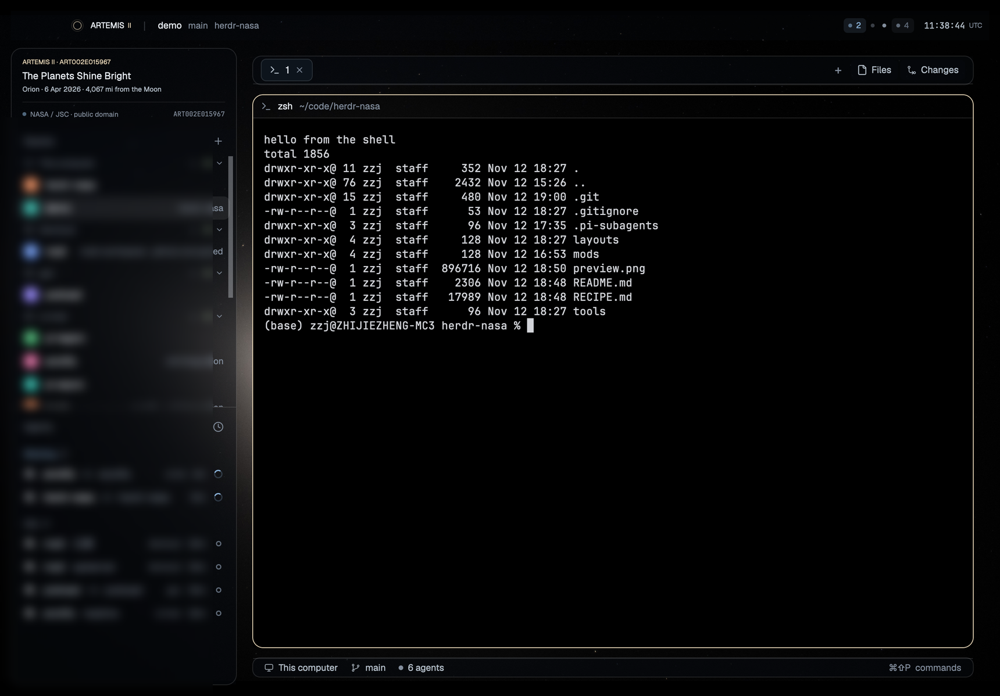

# Artemis

A Herdr layout whose ground is one NASA photograph: ART002E015967, *The Planets Shine Bright*
— the Artemis II crew's view of the Moon eclipsing the Sun from Orion, 6 April 2026, 4,067 mi
from the Moon. The whole frame, uncropped and ungraded, sits behind the entire window with
`fit: "contain"`; where the window is a different shape the layout paints the frame's own
border colour (`#030304`), so the empty part of the window is not a bar but the photograph
running out of stars. Nothing is filled flat: the rail, the tab strip, the status bar and the
panel are 25 % smoke, the pane and everything else take a 20 % tint, so the sky, the disc and its corona sit
behind the whole interface — and a terminal's paper is 25 % smoke, so the Moon's limb, its
craters and the corona read straight through the text. Every plate is a right angle: nothing
rounds a corner the photograph does not.

The status bar's right end carries a small system monitor: this computer's CPU and memory, a number
and a twelve-tick sparkline each, sampled every three seconds from `iostat` and `vm_stat` — the two
programs macOS ships for it, run read-only, no shell, no network.



## What you see

**The window.** Root `padding` `14`, `gap` `10`, `titlebar: none`, traffic lights at `[14, 13]`,
theme `graphite` with the `colors` map below, terminal padding `[20, 24]`, `terminal_opacity`
`0.25`, and `background` `{ "image": "backgrounds/artemis.jpg", "fit": "contain" }`.

**The ground.** The photograph, whole: 3:2, no crop, no grade, no vignette, no fade. `contain`
fits it inside the window and centres it. An aspect wider than 3:2 (a 16:10 window) leaves the
same near-black at the sides — 90 px either side at 2880 px wide; an aspect narrower than 3:2 (a
tall window) leaves it above and below, and the picture becomes a band across the middle. Those
bars are `canvas` `#030304` — measured off the frame's own outer 8 px (mean `2.84, 3.02, 3.61`)
— so the picture's edge and the window's edge are the same colour and there is no seam to see.
What the photograph contributes: its near-black sky (mean luminance 11 of 255) with the frame's
own stars, the Moon's disc in its left third, the corona's ring around it, and Saturn and Mars
as two small dots to the right of the disc.

**Smoked glass.** `colors.background` is `#0e162133` — 20 % of a dark blue-grey — so every node's
default fill is a thin smoke over the photograph rather than a hole or a slab, and a terminal's
own paper takes that colour's RGB (`#0e1621`) with `terminal_opacity` `0.25` blending it toward
the picture behind it: a shell pane reads (4, 6, 8) over the frame's black, and the Moon's limb,
the craters, the corona and the stars show through it, so the terminal is written on the
photograph rather than in a box on it. `terminal_padding` `[20, 24]` leaves the picture as a
mount inside each pane, which is where the glass reads even over the frame's black. `chrome` is
`#00000000` on purpose: the bar paints `chrome` (`mods/artemis-bar/main.js`, `.bg(t.chrome)`), so a
transparent `chrome` is what keeps the bar's type on the photograph instead of on a band across the
top of the window. Every plate that *should* be visible names the literal `#070b1240` instead.

**The four plates** carry the sturdier version of the same smoke — the literal `#070b1240`
(25 % of `#070b12`) with a `1px` border of `#ffffff1f`, and **no radius**:

| plate | size |
|---|---|
| `sidebar` (the rail) | 292 px, `min` 220, `max` 420 |
| `tabs` | 38 px tall, `window_drag: true` |
| `status` | 26 px tall — a row of two mods: `workspace-status` and `sysmon`, 308 px |
| `panel` (files / changes) | 340 px, `min` 280, `max` 900, `hidden: true` |

**The pane** is a bare frame: it inherits the 20 % tint, gets a `1px` `#ffffff1f` border (the
pane holding the keyboard takes `accent` `#e9d8b9` instead) and radius 0. The shipped `pane` header
sits 30 px at the top, always visible: program icon, title, folder, the agent's status (spinner,
`Needs you` while blocked, a dot when done), and — on hover only — split-right, split-down, zoom
and close. The header paints `theme().background`, i.e. a second 20 % tint, plus a 1 px `border`
rule: two thin layers rather than a slab, which is what keeps it from fighting the photograph.

**Top bar — 38 px, full width, `window_drag: true`, nothing painted.** Its type sits straight on
the photograph. One row at 11.5 px, left to right:

- **the eclipse mark, 16 px:** a 1 px outer ring at `${color}38` (22 % of the status colour),
  a 1 px rim in the status colour at 11 px, and a 5 px Moon disc in `#05080c`.
- `ARTEMIS` at 10.5 px `font_semibold` in `#e7ecf3`, then `II` at 9 px in `accent` `#e9d8b9`.
- a `│` separator at `${muted}44`, 11 px margin each side, then the active space's name at 12 px
  `foreground` (max 240 px) and its git branch (180 px); then, only when they differ from the space,
  the focused terminal's folder leaf (160 px, `~` at home) and the tab's name (200 px, only when the
  tab is named) at 11.5 px `dim` `#828d9c` — each truncated.
- a flexible spacer, then the **UTC clock**, `HH:MM:SS` at 11 px in `settings().font_family` (else
  JetBrains Mono), with `UTC` at 9 px `dim`, 5 px to its left.
- On Linux and Windows only (`window().buttons`): minimise, maximise/restore, close — 30 px
  each, glyphs in `dim`.

**Rail — 292 px.** One plate, its children flush to its edge (the 14 px the root keeps is what
insets the whole body from the window), holding, top to bottom:

1. **`spaces`** — the shipped `spaces` mod, `weight: 1`, `min` 90.
2. **`agents`** — the shipped `agents` mod, `weight: 1`, `min` 90.

**Work column** — `gap` 12 and `padding` `[10, 20]`, so the tabs, the pane and the status bar sit
10 px in from the top and bottom and 20 px in from the rail and the window edge: `tabs` 38 px with
the shipped `tabs` mod → `work-body` row, `gap` 10 → the pane area and the hidden panel →
`status` 26 px: `workspace-status` (weight 1) plus the monitor, 308 px.

**The status bar is a row, not a block**, since its right end holds a second mod: `workspace-status`
at `weight: 1` takes every pixel the monitor does not, so the palette hint stays where the shipped
mod puts it — just left of the seam. The row is `resizable: false`: the seam is a 1 px rule, not a
drag handle, and the monitor's 308 px cannot be moved by a stray press. The 25 % smoke and the
1 px `#ffffff1f` rule are on the row; the seam is a 1 px rule the monitor draws on its own left edge,
and both halves draw the same 1 px rule along their top edge, so the bar keeps the two thin layers
it always had.

**System monitor — the bar's right end.** `CPU`, the percentage, a twelve-tick strip; a 1 px rule;
`MEM`, `23.1/32G`, a strip of the same twelve ticks. Labels are 9 px `dim` `#828d9c`; numbers are
11.5 px in `settings().font_family` (else JetBrains Mono) in `muted` `#b7c2cd`, right-aligned in
fixed boxes — 34 px for the percentage, 58 px for the memory — so `%` and `G` stand in the same
column on every sample and the strips never shift. A strip is twelve 2 px ticks 2 px apart, 1–11 px
tall, 46 px in all: the older eleven in `idle` `#5f6a78`, the newest in `accent` `#e9d8b9`, so the
right edge of a strip is “now”. Nothing rounds, nothing fills: the ticks sit straight on the plate.

**Colours** are theme `graphite` plus the root `colors` map: `canvas` `#030304`, `background`
`#0e162133`, `surface` `#00000000`, `chrome` `#00000000`, `popover` `#0a1017`, `raised`
`#0d141c`, `input` `#0c131a`, `hover` `#ffffff0d`, `selected` `#ffffff14`, `border`
`#ffffff1f`, `foreground` `#e7ecf3`, `muted` `#b7c2cd`, `dim` `#828d9c`, `accent` `#e9d8b9`,
`accent_foreground` `#0a0c11`, `solid` `#111820`, `solid_foreground` `#0a0f15`, `selection`
`#2a3a4d66`, `working` `#8bb3d9`, `blocked` `#e08a6c`, `done` `#d8c8a6`, `idle` `#5f6a78`,
`unknown` `#47525f`, and the 16-colour ANSI ramp `#121821 #dd7a63 #a3bd97 #e3c88d #7fa6cf
#c39ecf #83bfc0 #c9d2dc #3b4655 #ef9781 #bcd4ab #f2dba3 #9cc0e6 #d8b5e2 #9ed8d6 #edf2f7`
(`ansi0`–`ansi15`). Fonts are the person's own; the layout sets none, but the clock asks for
`settings().font_family` (else JetBrains Mono) because it is numerals.

## How it behaves

**The mark, and nothing else, carries agent status.** The bar's 16 px eclipse reads two facts —
whether any agent is `blocked` and whether any is `working` — and nothing else; `done` and `idle`
render exactly like no agent at all:

| status | the mark |
|---|---|
| `blocked` | ring and rim coral `#e08a6c`, pulsing 0.35 → 1 every 900 ms |
| `working` | ring and rim cream `#e9d8b9`, pulsing 0.5 → 1 every 2400 ms |
| `done`, `idle`, none | ring and rim cream `#e9d8b9`, steady (indistinguishable) |

Counts are not repeated in the bar: the `agents` list in the rail is where they belong.

**The monitor reads this computer, every three seconds.** `iostat -c 2 -w 1` prints two samples one
second apart; the first is the average since boot, the second is the last second, so only the last
line is read — and a single-line answer is refused rather than passed off as “now” — and CPU is
`us + sy` from it. `vm_stat` is read in the same breath, and memory in use is `(active + wired +
compressor) × page size` over `hw.memsize`, asked once (and asked again if that fails). All three
ship with macOS, all are read-only queries, and a sample costs about 12 ms of CPU; the monitor
redraws once per sample and not between them.

**The first strip is flat.** The first sample fills all twelve ticks with itself, so a fresh window
shows a line at today's level instead of twelve claims of history it never saw; after that, one
tick per sample with the oldest dropping off the left — 36 s of history.

**Nothing here warns.** A lean machine is a line of short ticks, a busy one a comb: that is the
whole reading, and no colour changes with load, because the mark stays the bar's only status
carrier. The monitor also says nothing about the space's machine — the label at the other end of
the bar does that, and these numbers are always this computer's. On a machine without `iostat` and
`vm_stat` it draws nothing at all. A failed sample is not painted over: the numbers drop to `dim`
and the newest tick loses its cream, so nothing on the bar claims to be “now” while the reading is
stale; three failures in a row and it keeps trying once a minute instead of every tick.

**Clicks and hovers**

- The mod stops the left mouse-down on its clock and its window buttons, so a window drag never
  starts from them; the bar's and the tab strip's `window_drag` take every other press.
- Nothing in the bar is clickable — the mark is a lamp, not a button, and the monitor's block takes
  no press at all. Everything else — the space and agent lists, the tab bar, the pane headers,
  `workspace-status`, the panel — behaves as in Herdr's own layouts, because it is those shipped mods.

**What moves**

- Dragging the bar moves the window, and so does dragging the tab strip — both blocks are
  `window_drag: true`. On Linux and Windows the bar's own buttons minimise, maximise/restore and
  close it.
- Dragging the rail's right edge resizes it 220–420 px.
- The motion in the layout: the mark's pulse (native GPUI `.loop` on opacity, no JS redraws), the
  clock (one tick a second via `cx.timer.every(1000)`, notifying only when the formatted string
  changed) and the monitor's strips (one tick and one redraw per sample, every three seconds).

**Keys** — the layout binds nothing and leaves the person's `keys.json` alone; neither mod binds a
key. The bar mod runs no program and asks Herdr only to minimise, maximise or close the window; the
monitor runs `iostat`, `vm_stat` and a `sysctl -n hw.memsize` — once, unless it has to ask again —
and nothing else. Neither one touches the network.

## Built from

```
layouts/artemis.json          the window
layouts/artemis.svg           the picture Settings shows for this layout (root "preview")
backgrounds/artemis.jpg       the ground: the whole NASA frame, re-encoded
mods/artemis-bar/             main.js, mod.json {"place":"none","title":"Artemis bar"}
mods/sysmon/                  main.js, mod.json {"place":"none","title":"System monitor"}
```

**The node tree** (root is a `column`):

```
root  column  titlebar "none", traffic_lights [14,13], theme "graphite" + colors,
              background {image "backgrounds/artemis.jpg", fit "contain"},
              padding 14, gap 10, terminal_padding [20,24], terminal_opacity 0.25,
              preview "layouts/artemis.svg"
├ bar         block 38   window_drag  mod artemis-bar     (nothing painted)
└ body        row        gap 0
  ├ sidebar   column 292  min 220  max 420  radius 0
  │ │                    background "#070b1240"  border {1,"#ffffff1f"}
  │ ├ spaces  block weight 1  min 90  mod spaces   (no fill)
  │ └ agents  block weight 1  min 90  mod agents   (no fill)
  └ work      column gap 12  padding [10,20]  resizable false
    ├ tabs       block 38  window_drag  background "#070b1240"
    │                    border {1,"#ffffff1f"}  mod tabs
    ├ work-body  row  gap 10
    │ ├ main  block  content {tab "active", pane {...}}
    │ └ panel column 340  min 280  max 900  hidden true  background "#070b1240"
    │          border {1,"#ffffff1f"}
    │   └ panel-body  stack  active "files"  children: files, changes
    └ status       row 26  gap 0  resizable false  background "#070b1240"
                           border {1,"#ffffff1f"}
      ├ status-workspace  block weight 1  mod workspace-status
      └ status-sysmon     block 308  min 308  mod sysmon  (paints no fill)
```

The pane frame is exactly
`{"gap":10,"radius":0,"lone":true,"border":{"width":1,"color":"#ffffff1f"},"focus":{"width":1,"color":"accent"},"header":{"content":{"mod":"pane"},"height":30,"position":"top","reveal":"always"}}`
— no `background`, so it keeps the layout's 20 % tint, and `radius` 0 like every plate: the frame
must be stated in `content.pane`, not on the node.

**`mods/artemis-bar`** (no `props`) is one `h_flex().size_full()`: `.pl(mac ? 78 : 12).pr(4)`,
`.text_size(11.5)`, `.overflow_hidden()`, and `.bg(t.chrome)` — which is transparent, so the row
paints nothing and its type sits on the photograph. It imports `View` and `div` from `gpui-kit`,
`h_flex` from `gpui-base`, and `agents`, `focused`, `home`, `run`, `settings`, `spaces`,
`theme`, `window` from `herdr`; it runs `window.minimize` / `window.maximize` / `window.close` where
the system draws no buttons, and that is every `run` in the mod. The clock is `cx.timer.every(1000, …)` over `new Date()` formatted as
UTC. Every control is wrapped in `.on_mouse_down("left", (_e, cx) => cx.stopPropagation())`. The
mark is three nested `div()`s: `size(16).rounded(8).border(1)` at `${color}38`, inside it
`size(11).rounded(6).border(1)` at the status colour, inside that `size(5).rounded(3).bg("#05080c")`
— an opaque core, because `t.background` is translucent and the Moon's face must not be a hole.

**`mods/sysmon`** (no `props`) is one
`h_flex().size_full().items_center().justify_end().overflow_hidden()` with `.gap(10).px(12)` and
`.border_t(1).border_l(1)` in `theme().border` — no background, so the plate stays the row's and the
bar reads as one sheet with a 1 px seam, and no overflow, so a squeezed block clips its own content
rather than painting over its neighbour. It imports `View` and `div` from
`gpui-kit`, `h_flex` from `gpui-base`, and `exec`, `settings`, `theme` from `herdr`. Its programs:
`sysctl -n hw.memsize` (asked on the first sample, asked again if it failed), then
`iostat -c 2 -w 1` and `vm_stat` together on a `cx.timer.every(3000, …)` — the first sample fired at
once by `cx.timer.after(1, …)` — with a `busy` flag so a slow sample never stacks, and a `missing`
counter that, after three failures in a row, waits 20 ticks (63 s to the next try). Each metric is a
label (`w(24)`, 9 px, `dim`), a value (`h_flex().w(34 | 58).justify_end()` around a 11.5 px `div()`
in the person's mono face, `muted` while the reading is live and `dim` once it is not) and a strip:
`h_flex().gap(2).h(11).items_end()` over twelve `div().w(2)` ticks whose height is
`1 + round(pct / 10)` px, the newest one `accent` (`unknown` when stale) and the rest `idle`. Between
the two, a `div().w(1).h(11).bg(t.border)`. Parsing is three small regexes and one split: the last of
two data lines of `iostat`, and `vm_stat`'s `Pages active/wired down/occupied by compressor` plus the
page size in its header.

**Shipped mods used:** `spaces`, `agents`, `tabs`, `pane` (pane headers), `workspace-status`,
`files`, `changes`. Nothing needs `keys.json`, `programs.json`, `settings.json` or a theme file:
the look is all in the layout's root.

**The art.** `backgrounds/artemis.jpg` is the whole NASA frame: 8256×5504 re-encoded at 4096×2731
(Lanczos, JPEG quality 90, 4:2:0), 1.0 MB. No crop, no exposure change, no gradient, no fade, no
grain added — the photograph as published, at a size a GPU texture likes. The frame's own facts,
measured on the original: the Moon's disc centre `3357.5, 2794.0` (radii `1247.5 × 1238.0`), the
outer 8 px border `2.84, 3.02, 3.61` (hence `canvas` `#030304`), overall mean luminance `11.3`,
99.9th percentile `101` of 255.

```sh
python3 -c "from PIL import Image; Image.open('art002e015967.jpg').resize((4096,2731), Image.LANCZOS).save('backgrounds/artemis.jpg', quality=90, subsampling=1, optimize=True)"
```

## Watch out

- **`#00000000` is transparent.** An earlier build of this layout shipped the opposite claim
  ("a zero-alpha fill paints black") and built its design around it. It was wrong — the test that
  produced it put the image behind a dark plate and read the plate's own near-black, not the
  image. Verify a fill's transparency with a bright test image (`fit: "contain"` a solid red
  3000×2000 PNG): if the red reaches the pane, the fill is transparent.
- **The root `background` image renders behind every pane, and `fit: "contain"` works.** Both were
  denied by that same earlier build. The image is drawn first, the whole tree over it; only fills
  in the tree hide it.
- **The letterbox must be the picture's own border colour.** The frame's border is not `#000`
  and not the theme's canvas: it is `#030304` (mean `2.84, 3.02, 3.61` over the outer 8 px). A
  hard black there reads as a bar the moment the window is dimmed or the display is not
  sRGB-bright.
- **`contain` in a very tall window gives a band, and that is the deal.** The window here was
  2880×5060 once; the plate then occupies the middle 38 % with the same near-black above and
  below. Filling the height would crop the frame — the one thing this layout must not do. Don't
  "fix" it with `cover`.
- **`terminal_opacity` 0.25 makes a terminal's *paper* see-through, and only its paper.** Measured:
  a cell the program leaves unpainted (a shell's background, pi's page between its blocks) is
  composited with the photograph behind it, and its **glyphs keep full brightness** (a crop of the
  same text measures max 212 at `1.0` and at `0.4`); a cell whose background the program paints
  itself (a colour swatch, `vim`'s status line, pi's tool blocks) is untouched at every opacity.
  0.25 is where the frame still reads as a photograph (worst backdrop a glyph ever sits on is
  ~80, so cream text on it is ~4:1) while the pane keeps a faint floor; `0` leaves no floor at
  all, and `0.5` and above hides half the picture behind smoke.
- **`chrome` is `#00000000` on purpose.** The bar paints `theme().chrome`, so a transparent chrome
  is what keeps its type on the photograph; the four plates name the literal `#070b1240` instead.
  Don't set `chrome` to the plate colour: the bar would grow a band across the top of the window.
- **Every plate has radius 0, for the same reason.** A rounded frame around a terminal whose
  content, header and divider are all square leaves a sliver of square corner poking into the
  curve — that is the bug this layout exists to avoid. The pane's radius lives in
  `content.pane`, not on the node: setting the node's `radius` to 0 leaves the frame rounded.
  If you want round plates back, square the header first (`header` off, or `reveal: "hover"`, or a
  custom header mod that clips).
- **The app rewrites its own copy of this picture.** After a click, the app folder's
  `layouts/artemis.svg` came back with its `rx` values set to the clicked radii (`3.11` = 14 px at
  4.5 px per unit) — the same pass that writes click radii into `layouts/artemis.json`. The repo's
  hand-drawn file is the one that ships; don't copy the app's rewrite back.
- **`colors.background` is a 20 % tint, not a solid.** It keeps printed text readable over the
  corona without hiding the photograph; the four plates double it to 25 %. A new mod inside the
  work column sits on that same thin smoke, so give any new panel its own fill.
- **Menu surfaces are deliberately opaque** (`popover` `#0a1017`, `raised` `#0d141c`, `input`
  `#0c131a`): a menu over a photograph needs a floor, and `solid` is the opaque accent for filled
  buttons.
- **`spaces` and `agents` need `weight: 1` with `min: 90`**, or one of them takes the rail's
  height and the other is left with nothing.
- **The bar keeps 78 px clear on the left on macOS** (`pl(mac ? 78 : 12)`; 12 in fullscreen, which
  draws no traffic lights) for them at `[14, 13]`; drop it and the mark sits under the window
  buttons. Where the system draws no
  buttons (`window().buttons`), the bar draws its own at the right instead.
- **The `files` / `changes` panel starts hidden** and is reachable from the tab bar; it is 340 px
  (`min` 280, `max` 900) and takes its width from the pane area.
- **The monitor's memory figure is not `top`'s.** `top` prints `31G used … 252M unused`, which is the
  total minus free; a healthy Mac reads 99 % that way forever, because file cache counts as used.
  The monitor adds the pages actually in use — `(active + wired + compressor) × page size` — which
  is `23.1/32G` on the same Mac at the same moment. Don't “correct” it to `total − free`.
- **`iostat`'s first line is the average since boot.** `-c 2 -w 1` prints two samples a second
  apart; only the second is the reading. A build that takes the first line reports ~20 % on this
  Mac and barely moves. Take the last data line and its last six fields (`us sy id 1m 5m 15m`),
  whatever disks stand before them.
- **`vm_stat`'s page size is 16384 on Apple Silicon and 4096 on Intel** — read it from the header
  (`page size of N bytes`); assuming 16384 reports memory 4× off on an Intel Mac.
- **The block is 308 px for 306 px of content.** 1 px border + 2 × 12 px padding + 281 px
  (CPU `24 + 7 + 34 + 7 + 46`, then `10 + 1 + 10`, then MEM `24 + 7 + 58 + 7 + 46`) = 306; the two
  spare pixels are `justify_end`'s slack, so nothing is stretched. Change `TICKS` or a `width`
  and the layout's `px` must change with it — a short block clips the CPU label on the left, not
  on the right.
- **The `status` row is `resizable: false`, and that is load-bearing.** Rows are draggable at their
  boundaries by default, so without it the seam is a handle that can squeeze the monitor under its
  306 px of content — and a clicked size persists in `layouts/.state/`. The block also carries
  `min: 308` as a second guard.
- **`herdr-app check` proves little about this mod.** `render()` returns an empty `div()` until a
  sample has landed, so the check exercises `init`'s two timers and that empty block — and no program
  at all, since the samples start on the timer; the numbers and their strips are built only in the
  window. (This is how a leftover variable name got past the check and into a bar that would not
  re-render.)
- **`iostat` sleeps one second per sample, and that is the cost.** `top -l 2 -n 0 -s 1` measures the
  same interval for ~0.7 s of CPU; `iostat` spends ~10 ms and `vm_stat` ~2 ms. Don't swap it for
  `top`, and don't poll faster than the bar can be read.
- **Three failures, then one try a minute.** On a machine that has neither program an every-tick
  retry would spawn a failing `exec` for as long as the window lives: `missing` sets `wait` to 20
  ticks after the third failure in a row (63 s to the next try), so a machine without the programs
  costs almost nothing and a transient timeout still recovers. A failed sample also paints nothing as
  “now” — `live` false means `dim` numbers and no cream tick.
- **The monitor paints no fill of its own.** The plate, its rule and its smoke belong to the
  `status` row. Give the mod a `.bg(...)` and the bar becomes two plates with a seam down it.
- **The photograph is public domain; keep the credit.** The layout ships the frame re-encoded,
  not the 8256×5504 original; both are NASA/US-government works. Credit NASA / JSC, imply no
  endorsement.

## Done when

Copy `layouts/`, `mods/` and `backgrounds/` into `~/.config/herdr-app/`, then:

```sh
herdr-app check ~/.config/herdr-app/mods/artemis-bar           # exit 0
herdr-app check ~/.config/herdr-app/mods/sysmon                # exit 0
herdr-app do layout.switch --name artemis
herdr-app status                                               # "layout": "artemis", "errors": []
herdr-app shot /tmp/artemis.png
```

…and in the window:

- the photograph is whole: nothing is cropped, and where the window is a different shape the
  bars above and below (or either side) blend into the frame's own edge with no line to see;
- the rail opens with `Spaces` at once — no title block, no credit; then `Agents`;
- every plate is a right angle: rail, tab strip, pane and status bar meet their neighbours
  squarely, and the pane's header is two thin layers (20 % tint + a 1 px rule), not a slab;
- the bar shows the eclipse mark, `ARTEMIS` `II`, the active space with its branch (plus a folder and
  a named tab when they differ), and a UTC clock that advances every second — and nothing else;
- a pane running a shell shows the picture behind its text (the Moon's limb, its craters and the
  corona read through), pi's page shows it too, and the blocks pi paints itself stay opaque;
- an agent that starts working makes the mark pulse; blocking turns it coral and pulses it
  faster; both stop when nothing is working or blocked;
- the status bar's right end reads `CPU 33% ▁▁…` and `MEM 23.1/32G ▁▁…`: two numbers in the bar's
  mono face with `%` and `G` in fixed columns, and two twelve-tick strips whose newest tick is cream
  and the rest grey-blue, updating every three seconds without the layout moving;
- `yes > /dev/null` in a few shells drives the CPU into the 90s and the strip stands up into a comb
  over a few samples, then falls back when they stop; memory barely moves;
- the seam between `workspace-status` and the monitor is one 1 px rule and cannot be dragged; the
  bar's top edge is still two thin layers;
- dragging the bar moves the window, dragging the rail's edge resizes it, and no press that
  starts on a control ever does either;
- the tab bar's Files button opens a 340 px panel on the right and nothing else moves;
- `ctrl-shift-l` returns to the person's other layouts.
